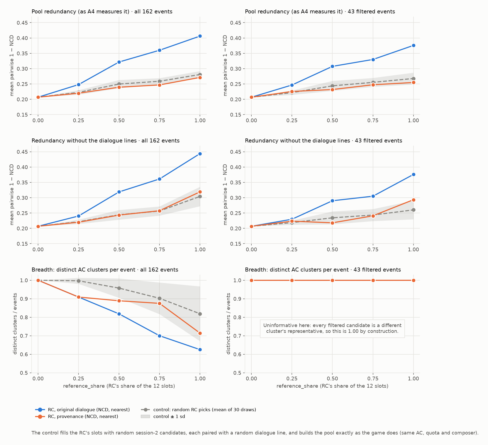
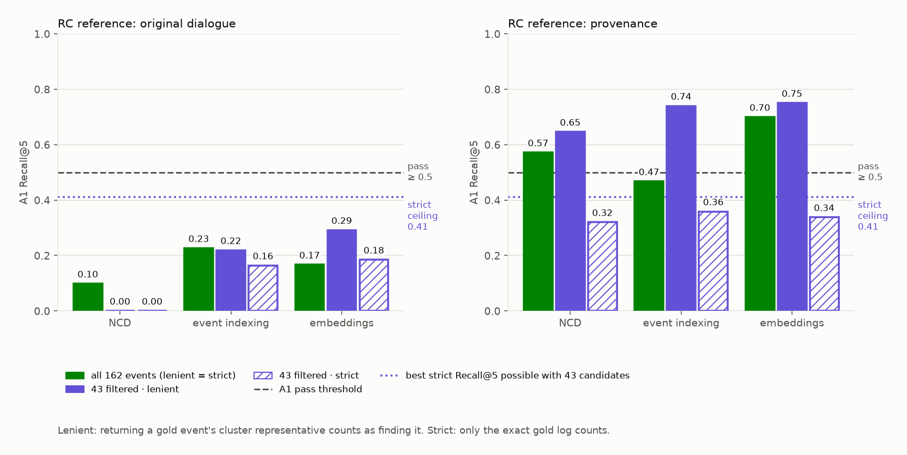

# Two-channel sifting: Week 0 pilot summary

*Prepared 2026-11-23, covering 2026-11-17 to 2026-11-23. Corpus: one colony, two sessions (`SimulatedDay1`, `SimulatedDay2`).*

## TL;DR

- **The reference channel (RC, also called CC) only finds continuity when it matches on the right thing.** Matching the dialogue the player saw against session-2 event logs fails, whatever the measure. Matching the **session-1 logs each dialogue line was generated from** ("provenance") works: with the game's own NCD, the RC finds the author's continuity matches (Recall@5 0.10 → 0.57, 0.65 with filtered candidates).
- **Provenance also fixes redundancy.** The RC no longer floods the pool with near-identical fight lines. Its pools are no more redundant than random RC picks would make them. **A random-pick control shows the "dial" is mostly construction** (section 3.5): the share controls how much of the pool is continuity material, not how focused the RC makes it.
- **Embeddings aren't needed.** On the original dialogue they fail too (0.17). With provenance, NCD or event indexing come within reach of them without any language model, which supports dropping embeddings for domain generalisation.
- **Next, three implementation steps (detailed at the end):**
  1. implement dialogue provenance in the game and the Python pipeline;
  2. let the RC pick from **all** session-2 events by default (revised after strict scoring: filtering to the AC's 43 representatives only looked better under lenient scoring);
  3. a set of smaller fixes.

---

## 1. Process

| step | what we did |
|---|---|
| **Set-up** | Checked the handoff against both repos and reported mismatches before building. For example, the CLI is `sipport.py`, the RC ranking already runs in Python with **event-first** NCD, and dialogue lives in its own file. |
| **Pilot framework** | Built `experiments/` (headless Python, no game changes): loading, NCD, name masking, RC selectors, and a line-by-line port of the game's pool composer. **The port reproduces all three saved Nov 8 game pools exactly.** |
| **Data clean-up** | Removed a truncated "Ackmann" log and dialogue S116 (a retelling of S111). Froze the event codes so the author's gold stayed valid. |
| **Tests A1–A4** | A1: does the RC find the author's continuity matches? A2: does it match on names? A3: is what it picks redundant? A4: does the share act as a breadth/depth dial? (A5, readers' blind comparison, and the A2 interpretation are on hold.) |
| **Iterations** | Changed one thing at a time: • the **reference**: dialogue → session-1 selected logs → provenance • the **candidates**: all 162 session-2 events → the 43 the AC keeps after filtering • the **similarity measure**: NCD → event indexing → embeddings |

Author input throughout: gold matches (two sets), 88 topic tags, provenance confirmation, and decisions such as keeping MMR λ at 0.7 and avoiding embeddings.

## 2. Approaches tried

### Reference sets (what the RC matches against)

| reference | what it is | finding |
|---|---|---|
| **dialogue** (original) | the 8 lines colonists spoke in session 1, as the game logs them | Paraphrase, so it can't be matched to events. NCD falls back to colonist names. |
| **dialogue, stripped** | the same, without the "X said '…'" frame and opening vocative | Doesn't help (Recall@5 0.10 → 0.07). Names weren't the obstacle; paraphrase was. |
| **selected logs** | the 13 logs the AC selected in session 1 | Easy to match, but mostly by **exact repeats**. Puts duplicate lines in the pool (the composer deduplicates by `_ID_`, not text). |
| **provenance** | the dialogue line is shown and pooled, but scored through the session-1 logs it was generated from | Best overall (below). |

### Candidate sets (which session-2 events the RC may pick)

| candidates | what it is | finding |
|---|---|---|
| **all 162** | every distinct session-2 event (the game today) | Near-duplicates can take every RC slot. |
| **filtered 43** | the AC's cluster representatives at NCD 0.5, before traversal | The 13 fight lines collapse to 2, so redundancy drops. Reuses the AC's own clustering. |

### Similarity measures (how the RC scores a link)

| measure | how | finding |
|---|---|---|
| **NCD** | compression distance on descriptions (the game today) | Behaves like **repetition priming**: it only matches shared wording. |
| **event indexing** | shared entities (IDF-weighted) 0.4, NCD text 0.3, map distance 0.2, log type 0.1, from the logs' structured fields; after the event-indexing model (Zwaan et al., 1995) | Makes links NCD can't (walrus shot → walrus burial). With dialogue it amplifies name matching. |
| **embeddings** | all-MiniLM-L6-v2 cosine, run locally | Comparison only. Fails on dialogue without provenance; dropped for domain generalisation. |

### Redundancy controls

`cap` (at most 2 events per reference line), `mmr` (Maximal Marginal Relevance, λ 0.7), and `mmr_ix` (MMR whose redundancy term uses event indexing).

## 3. Major findings

### 3.1 Dialogue alone doesn't work, whatever the measure

A1 Recall@5 on the original dialogue (pass ≥ 0.5):

| | NCD | event indexing | embeddings |
|---|---|---|---|
| 162 events | 0.10 | 0.23 | 0.17 |
| 43 events | 0.00 | 0.22 | 0.29 |

- **Names, not content:** NCD matches on colonist names (A2). With all 162 events, the treeline line ("I watched the far treeline for more raiders") takes every RC slot with blow-by-blow fight lines between Odette and Stench: 1 dialogue line in the pool, redundancy 0.50.
- **Masking doesn't help:** replacing names with tokens, or deleting them, reshuffles the top pairs but doesn't improve recall (0.10 → 0.06–0.07).
- **MMR spreads, but can't fix:** it spreads the slots over 3 lines (redundancy 0.38), but it can't make the matches right.

### 3.2 Provenance fixes it, even with plain NCD

| | 162 · NCD | 162 · index | 162 · embeddings | 43 · NCD | 43 · index | 43 · embeddings |
|---|---|---|---|---|---|---|
| **A1 Recall@5** | **0.57** | 0.47 | 0.70 | **0.65** | **0.74** | 0.75 |
| A1 MRR | 0.65 | **0.81** | 0.66 | 0.74 | 0.72 | 0.77 |
| A3 `nearest`: lines / redundancy | 3 / 0.26 | 3 / 0.26 | 3 / 0.26 | 3 / 0.29 | 2 / 0.27 | 2 / 0.27 |
| A4 ρ, all labels / first label (pass ≤ −0.7) | −0.76 / −0.73 | −0.81 / −0.81 | −0.83 / −0.83 | −0.90 / −0.68 | −0.81 / −0.79 | −0.89 / −0.81 |

- **A1:** gold events jump from ranks 50–100 to the top 3 for most lines. The treeline line now finds "Boyd watching for targets" (rank 77 → 1), because its sources are "Odette watching for targets" and the tribal raid, not the fistfight.
- **A3:** with the game's own `nearest` selector, the pool spreads over 3 dialogue lines with the lowest redundancy of any dialogue set-up. The flooding came from name matching only.
- **A4:** breadth falls as the share rises under both ways of counting multi-topic tags (original dialogue's dial depended on those tags: first label −0.53). The random-pick control in section 3.5 shows this fall is mostly construction, though.
- **Which measure:** NCD and event indexing complement each other. Event indexing finds the walrus and anteater burials (rank 1–4 instead of 27–36). NCD keeps the exact-wording matches that event indexing loses ("watching for targets": 1 vs 16).

### 3.3 Provenance vs embeddings

- **Provenance is the bigger lever.** It raises every measure (NCD 0.10 → 0.57, embeddings 0.17 → 0.70). Changing the measure on the original line peaks at 0.29.
- **Embeddings alone don't understand the game.** They miss that "walrus" is a tribesperson (burial at rank 13) and that the dialogue's gazelles and grizzly are logged animals (ranks 50 and 22). They also give no dial (A4 ρ −0.61, first label +0.04).
- **With provenance and filtered candidates,** event indexing is within 0.01 of embeddings (0.74 vs 0.75) without a language model, under lenient scoring. Under strict scoring all three measures fall to 0.32–0.36 (section 3.6).

### 3.4 Selected logs work, but by repetition

With the 13 selected logs as the reference, NCD reaches 0.33 (0.16 without exact repeats) and event indexing 0.72. Half the share-0.5 pool is the same three logs written twice, though. Provenance keeps the advantage of event-like references while showing the player dialogue, and only the dialogue line enters the pool, so the duplicate problem goes away.

### 3.5 The dial is mostly construction (random-pick control)

A reviewer pointed out that redundancy may rise with the share just because of how the pool is built. To test it, the RC's slots were filled with **random** session-2 candidates (30 draws per share) and the pool composed exactly as the game does. Details are in `out_compare/RANDOM_CONTROL.md`.

- **Random picks raise redundancy too** (0.21 → 0.28 at share 1). The AC picks rare, mutually different logs on purpose, so replacing any of its slots with ordinary events raises redundancy. That rise is construction.
- **Original dialogue goes well beyond it** (0.41; breadth 0.62 distinct clusters per event vs 0.82 for random). That narrowing is the RC's doing, through the name-driven fight lines.
- **Provenance stays at the random level** (0.27 vs 0.28; 0.26 vs 0.27 with filtered candidates). Breadth matches random up to share 0.75 and falls below it only at share 1, within the control's spread. Its topic-based A4 pass and the ρ ≈ 0.99 for redundancy therefore can't be credited to the RC.
- **What can be claimed:** with provenance, the share controls how much of the pool is continuity material, and that material is relevant (A1) without adding redundancy beyond chance. A4 should be redefined as the effect relative to the random control.
- The earlier caveat still applies: the 5 seeds barely change the AC, so most of the pools behind each ρ are near-copies.

### 3.6 Strict scoring: filtering's A1 gain is a scoring artefact

A second review point: with filtered candidates the pilot scored A1 **leniently**, crediting a returned cluster representative for every gold event in its cluster. **Strict** scoring counts only the exact gold log. Details are in `out_compare/STRICT_SCORING.md`.

- **With all 162 events the two are identical**, and provenance passes (NCD 0.57, embeddings 0.70).
- **With the 43 filtered events, strict scoring roughly halves recall:** provenance falls from 0.65–0.75 to 0.32–0.36 and fails.
- **The threshold is out of reach there by construction.** Only 10 of the 30 gold events are representatives, so a perfect RC would reach at most 0.41. Provenance gets 78–87% of that ceiling, so it still ranks the reachable events well.
- **So filtering doesn't improve A1;** strictly it lowers it (NCD 0.57 → 0.32). Its other benefit, lower redundancy, isn't needed with provenance (section 3.5).

### 3.7 Smaller findings

- **Concatenation order matters for NCD** with dialogue: only 68% top-5 overlap between event-first and dialogue-first. It barely matters for event-like references (82%).
- **Actor match is weak evidence:** 41% of all dialogue × event pairs share a colonist by chance (mostly Stench).
- **Filtered candidates + event indexing + selected logs gives no dial** (A4 ρ +0.13): topics stay at 8–9 while redundancy rises. That's continuity without losing breadth, which is interesting for the game but contradicts A4's claim.
- **MMR with event-indexing redundancy** breaks up the dialogue fight lines (all 3 lines at λ 0.5). At the default λ 0.7 it stays one line short.

## 4. Psychology framing

- **AC = bottom-up salience:** novelty and surprise, like the orienting response.
- **RC = selection history** (Awh, Belopolsky & Theeuwes, 2012): past selections bias current selection. With NCD it behaves like **priming of pop-out / repetition priming** (Maljkovic & Nakayama, 1994): surface features that repeat win.
- **Why dialogue failed and provenance works:** dialogue is a **gist** trace and the source logs are **verbatim** traces (fuzzy-trace theory, Reyna & Brainerd). Retrieval works when the cue matches how the memory was encoded (encoding specificity, Tulving & Thomson). Provenance lets the player experience continuity through gist while selection uses the verbatim trace.
- **Event indexing** follows the situation-model links readers use to keep stories coherent (Zwaan, Langston & Graesser, 1995). It is related to "object files" (Kahneman, Treisman & Gibbs, 1992).
- **The redundancy controls:** MMR resembles **inhibition of return** (Klein, 2000); filtered candidates resemble attending to **category prototypes** rather than instances (Rosch).

## 5. Recommended implementation steps

> ### Step 1 — Implement dialogue provenance
> - **Generation (Python, `story_llm.py` + prompts):** give the dialogue step the pool logs (with `_ID_`s) as well as the narrative. Have it return each line together with the IDs of the logs it is about. Drop IDs that aren't in the pool; a line left without valid IDs has no provenance.
> - **Logging (C#, `DialogueManager.cs`, needs approval):** write provenance to a **sidecar file** (dialogue `_ID_` → source IDs + full source log text) rather than changing the log line format, which every parser depends on. Storing the text keeps session 2 self-contained.
> - **Reference channel (Python, `reference_sifting_channel`):** score a dialogue line by the smallest distance from any of its sources to each event, falling back to the line itself without provenance. The pool still receives the dialogue line. **Keep NCD**: it passes with provenance and needs no entity vocabulary or weights; event indexing can be an option later.

> ### Step 2 — RC candidates: all events by default, filtering as an option *(revised)*
> - **Why all events:** under strict scoring, provenance passes A1 with all 162 events (NCD 0.57) and fails with the 43 filtered ones (0.32, ceiling 0.41). The earlier advantage of filtering (0.65) only held under lenient scoring. Provenance already keeps redundancy at the random level with all events, so filtering isn't needed for that either.
> - **Keep filtering as a setting** (the AC's existing `unique_logs_after_filtering`, so no extra clustering) for long sessions with thousands of distinct logs, where comparing every source against every log gets expensive. When it's used, score A1 strictly and report the ceiling.
> - With provenance, "all logs vs selected" on the reference side is moot: the sources are by construction session-1 selected logs.

> ### Step 3 — Other changes
> 1. **A dedicated dialogue tag (`DLG_`)**, instead of detecting dialogue by the "said '…'" pattern in `SL_` lines.
> 2. **Consistent name format** in dialogue logs: `DialogueManager.cs` writes short names, but the saved file uses full names.
> 3. **Quota accounting as a parameter:** whether the dialogue line counts against the RC's slots, which caps the RC at 3 lines at share 0.5.
> 4. **Skip MMR and text deduplication in the game for now:** with provenance + filtering, `nearest` already gives 3 lines and low redundancy.
> 5. **Commit the pilot work:** everything since the first pilot commit is uncommitted.
> 6. **Before the paper:** more colonies and sessions, and RQ1 restated more modestly (the share moves the pool from varied to focused, with redundancy as the main measure).

## 6. Caveats

- One colony, two sessions, 8 dialogue lines and 13 selected logs; single author's gold and topic tags.
- Provenance was simulated by hand-mapping each line to its sources. In the game the LLM will produce it and can be wrong.
- Event-indexing weights and the MMR λ were set by hand, not fitted.
- Seeds barely vary the AC, so spreads over seeds understate real variability.
- Filtered-candidate A1 numbers in the comparison reports are lenient (a representative is credited for its whole cluster); strict scores are in `out_compare/STRICT_SCORING.md`.

## 7. Where everything is

| file | contents |
|---|---|
| `experiments/README.md` | how to run the pilot |
| `out*/PILOT_REPORT.md` | per-run report (one folder per reference × candidates × similarity) |
| `out_compare/REFERENCE_COMPARISON.md` | dialogue vs selected logs (NCD, embeddings, A2 masking) |
| `out_compare/CANDIDATE_FILTER_COMPARISON.md` | 162 vs 43 candidates |
| `out_compare/EVENT_INDEX_COMPARISON.md` | NCD vs event indexing, `mmr_ix`, λ sweep |
| `out_compare/DIALOGUE_LOGGING_COMPARISON.md` | original vs stripped vs provenance, dial plots |
| `out_compare/PROVENANCE_VS_EMBEDDINGS.md` | provenance vs embeddings |
| `out_compare/dialogue_pool_nearest_vs_mmr.md` | example pools with and without MMR |
| `out_compare/RANDOM_CONTROL.md` | random-pick control for the breadth/depth dial |
| `out_compare/STRICT_SCORING.md` | A1 under strict vs lenient scoring |
| `gold_matches*.csv`, `topic_tags.csv`, `dialogue_provenance.csv`, `event_codes.csv` | author inputs (never regenerated) |
