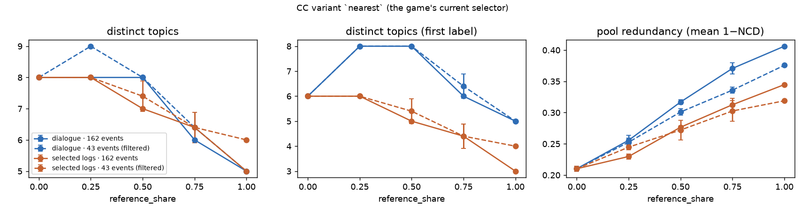

# CC candidates: all 162 session-2 events vs the 43 the AC keeps after filtering

Four set-ups, crossing two **reference sets** (what the CC matches against) with two **candidate sets** (which session-2 events the CC may pick). Everything else is identical: session 2 = `SimulatedDay2` (162 distinct events), AC at NCD threshold 0.5 with `least_frequent`, NCD event-first as in the game, the game's pool composer, total 12.

**Filtered candidates** = the AC's `unique_logs_after_filtering` at threshold 0.5: one representative (medoid) per cluster of near-duplicate events, taken before dendrogram traversal. In A1 a gold event folded into a cluster counts as found when its representative is retrieved, so several gold events can become one target.

NCD only. Embeddings are left out on purpose, and A2 (name masking) is not repeated here; see `REFERENCE_COMPARISON.md` for both.

|  | dialogue · 162 events | dialogue · 43 events (filtered) | selected logs · 162 events | selected logs · 43 events (filtered) |
|---|---|---|---|---|
| reference lines | 8 | 8 | 13 | 13 |
| CC candidates | 162 | 43 | 162 | 43 |
| gold events (author) | 30 | 30 | 20 | 20 |
| gold targets after mapping to representatives | 30 | 18 | 20 | 15 |
| gold events that are candidates themselves | 30 | 10 | 20 | 7 |

## At a glance

|  | dialogue · 162 events | dialogue · 43 events (filtered) | selected logs · 162 events | selected logs · 43 events (filtered) |
|---|---|---|---|---|
| A1 NCD Recall@5 (pass ≥ 0.5) | 0.10 | 0.00 | 0.33 | 0.46 |
| A1 NCD MRR | 0.20 | 0.09 | 0.40 | 0.43 |
| A3 `nearest`: reference lines in pool | 1 | 3 | 3 | 3 |
| A3 `nearest`: CC redundancy | 0.50 | 0.43 | 0.30 | 0.29 |
| A3 `mmr`: CC redundancy | 0.38 | 0.35 | 0.30 | 0.29 |
| A4 ρ(share, topics), `nearest` (pass ≤ −0.7) | -0.89 | -0.82 | -0.96 | -0.90 |
| A4 same, first label only | -0.53 | -0.46 | -0.96 | -0.90 |

With embeddings out of the picture, A1 is NCD's alone, and it fails in all four set-ups; the best is selected logs with filtered candidates (0.46).

## A1 — does NCD find the events the author says continue a reference line?

| set-up | Recall@5 | Recall@10 | MRR | gold targets |
|---|---|---|---|---|
| dialogue · 162 events | 0.098 | 0.137 | 0.205 | 30 |
| dialogue · 43 events (filtered) | 0.000 | 0.323 | 0.090 | 18 |
| selected logs · 162 events | 0.331 | 0.346 | 0.404 | 20 |
| selected logs · 162 events, no exact repeats | 0.164 | 0.182 | 0.211 | 17 |
| selected logs · 43 events (filtered) | 0.462 | 0.577 | 0.435 | 15 |
| selected logs · 43 events (filtered), no exact repeats | 0.462 | 0.577 | 0.377 | 14 |

Each reference set has its own gold file, so compare the two candidate sets *within* a reference set; across reference sets the numbers say how findable each kind of continuity is, not the same items.

NCD rank of the best-ranked gold event per reference line, dialogue (lower is better; filtered ranks are out of 43 candidates, unfiltered out of 162):

| line | reference text | 162 events | 43 events |
|---|---|---|---|
| S104 | Lidia 'Stench' Schmitt said 'Boyd, I had those fifty-six steel beams st… | 49 | 15 |
| S107 | Dillon 'Boyd' Boyd said 'Stench, my hands shook when the raiders struck… | 22 | 8 |
| S110 | Odette 'Odette' O'Neill said 'Stench, I watched the far treeline for mo… | 73 | 17 |
| S111 | Odette 'Odette' O'Neill said 'Stench, those gazelles were grazing amid … | 86 | 30 |
| S105 | Lidia 'Stench' Schmitt said 'Boyd, my shot dropped that walrus in a spr… | 5 | 9 |
| S108 | Dillon 'Boyd' Boyd said 'Stench, I hit that walrus, then I stung the an… | 3 | 6 |
| S112 | Odette 'Odette' O'Neill said 'Boyd, a grizzly at camp's edge was troubl… | 67 | 23 |
| S106 | Lidia 'Stench' Schmitt said 'Boyd, Papyrus trailed me all the way to St… | 1 | 9 |

NCD rank of the best-ranked gold event per reference line, selected logs (lower is better; filtered ranks are out of 43 candidates, unfiltered out of 162):

| line | reference text | 162 events | 43 events |
|---|---|---|---|
| J197 | A(n) grizzly bear standing. | 1 | 1 |
| J784 | Stench hauling steel x56 to Stockpile zone 1. | 1 | 1 |
| J6248 | Papyrus following Stench. | 1 | 1 |
| J23595 | Stench moving. | 29 | 19 |
| L0 | A group of tribespeople from Confederacy of Loucó have arrived nearby. … | 23 | 10 |
| J11087 | Boyd relaxing socially. | 80 | 17 |
| J11165 | Odette watching for targets. | 1 | 1 |
| b57 | Boyd fired timidly at Walrus. | 23 | 8 |
| b74 | Stench hit Walrus with a shot. | 28 | 24 |
| b81 | Walrus died. | 104 | 39 |
| b88 | Boyd's shot hit Anteater. | 18 | 5 |
| J19592 | A(n) gazelle consuming grass. | 1 | 1 |
| L5 | Chunks of a spacecraft have impacted nearby. You can deconstruct them t… | 68 | 20 |

- **Dialogue:** filtering moves NCD's hits down from the very top but brings more into the top 10 (Recall@5 0.10 → 0.00, Recall@10 0.14 → 0.32, MRR 0.20 → 0.09). The lines NCD matched best before (walrus, Papyrus/Stockpile) drop a few places, because the events they matched are not representatives and their representatives share less wording. The lines it matched worst move up, but only because there are fewer candidates to rank.
- **Selected logs:** filtering helps NCD (Recall@5 0.33 → 0.46), but partly by construction: several gold events merge into one target, and the exact repeats mostly drop out of the candidates (e.g. *grizzly bear standing* is represented by *grizzly bear wandering*).

## A3 — redundancy in what the CC picks (share 0.5, total 12)

Each cell: reference lines in the pool / CC redundancy (mean 1−NCD over all pairs of CC events).

| variant | dialogue · 162 events | dialogue · 43 events (filtered) | selected logs · 162 events | selected logs · 43 events (filtered) |
|---|---|---|---|---|
| nearest | 1 / 0.50 | 3 / 0.43 | 3 / 0.30 | 3 / 0.29 |
| cap | 2 / 0.45 | 2 / 0.40 | 3 / 0.30 | 3 / 0.29 |
| mmr | 3 / 0.38 | 3 / 0.35 | 3 / 0.30 | 3 / 0.29 |
| cap+mmr | 3 / 0.38 | 3 / 0.35 | 3 / 0.30 | 3 / 0.29 |

- **Dialogue:** filtering alone does part of what MMR did: `nearest` goes from 1 reference line and redundancy 0.50 to 3 lines and 0.43 (MMR on all events: 0.38), because the 13 near-identical fight lines collapse to 2 representatives. Filtering plus MMR gives the lowest redundancy (0.35).
- **Selected logs:** redundancy was already low and stays so; every variant picks 3 different reference lines in both candidate sets, so cap and MMR have nothing to fix.

## A4 — is the share a breadth/depth dial?

| set-up | variant | ρ(share, topics) | first label only | ρ(share, redundancy) | passes |
|---|---|---|---|---|---|
| dialogue · 162 events | nearest | -0.89 | -0.53 | 0.99 | yes |
| dialogue · 162 events | mmr | -0.79 | 0.15 | 0.99 | yes |
| dialogue · 43 events (filtered) | nearest | -0.82 | -0.46 | 0.99 | yes |
| dialogue · 43 events (filtered) | mmr | -0.79 | -0.34 | 0.99 | yes |
| selected logs · 162 events | nearest | -0.96 | -0.96 | 0.99 | yes |
| selected logs · 162 events | cap | -0.96 | -0.96 | 0.99 | yes |
| selected logs · 43 events (filtered) | nearest | -0.90 | -0.90 | 0.96 | yes |
| selected logs · 43 events (filtered) | cap | -0.90 | -0.90 | 0.96 | yes |

`dialogue · 162 events` · `nearest`

| share | distinct topics | first label | redundancy | reference lines | AC–CC overlap |
|---|---|---|---|---|---|
| 0.0 | 8.00 | 6.00 | 0.21 | 0.00 | 0.00 |
| 0.25 | 8.00 | 8.00 | 0.26 | 1.00 | 0.00 |
| 0.5 | 8.00 | 8.00 | 0.32 | 1.00 | 0.00 |
| 0.75 | 6.00 | 6.00 | 0.37 | 2.00 | 0.00 |
| 1.0 | 5.00 | 5.00 | 0.41 | 4.00 | 0.00 |

`dialogue · 43 events (filtered)` · `nearest`

| share | distinct topics | first label | redundancy | reference lines | AC–CC overlap |
|---|---|---|---|---|---|
| 0.0 | 8.00 | 6.00 | 0.21 | 0.00 | 0.00 |
| 0.25 | 9.00 | 8.00 | 0.25 | 2.00 | 0.00 |
| 0.5 | 8.00 | 8.00 | 0.30 | 3.00 | 0.00 |
| 0.75 | 6.40 | 6.40 | 0.34 | 4.00 | 0.00 |
| 1.0 | 5.00 | 5.00 | 0.38 | 5.00 | 0.00 |

`selected logs · 162 events` · `nearest`

| share | distinct topics | first label | redundancy | reference lines | AC–CC overlap |
|---|---|---|---|---|---|
| 0.0 | 8.00 | 6.00 | 0.21 | 0.00 | 0.00 |
| 0.25 | 8.00 | 6.00 | 0.23 | 1.00 | 3.00 |
| 0.5 | 7.00 | 5.00 | 0.28 | 3.00 | 4.00 |
| 0.75 | 6.40 | 4.40 | 0.31 | 4.00 | 4.00 |
| 1.0 | 5.00 | 3.00 | 0.34 | 5.00 | 4.00 |

`selected logs · 43 events (filtered)` · `nearest`

| share | distinct topics | first label | redundancy | reference lines | AC–CC overlap |
|---|---|---|---|---|---|
| 0.0 | 8.00 | 6.00 | 0.21 | 0.00 | 0.00 |
| 0.25 | 8.00 | 6.00 | 0.24 | 1.00 | 2.80 |
| 0.5 | 7.40 | 5.40 | 0.27 | 3.00 | 2.80 |
| 0.75 | 6.40 | 4.40 | 0.30 | 4.00 | 3.20 |
| 1.0 | 6.00 | 4.00 | 0.32 | 6.00 | 3.20 |

All four pass the agreed rule (multi-topic tags count every topic). Only the selected-log set-ups also pass when each tag counts as its first topic; with dialogue the drop in topics rests on the multi-topic "watching for targets" tags in either candidate set, and with filtered candidates the topic count is not even monotone (9 at share 0.25). Filtering lowers pool redundancy at every share above 0 for dialogue. For selected logs it cuts the descriptions that appear twice in the pool from 3 to 1: *Papyrus following Stench* is itself a representative, so its session-2 copy can still be picked next to the session-1 line.

## The pool at share 0.5 (seed 42), as the LLM would see it

`dialogue · 162 events` · `nearest`

| channel | description |
|---|---|
| CC (ref) | Odette 'Odette' O'Neill said 'Stench, I watched the far treeline for more raiders.' |
| AC | Boyd watching for targets. |
| AC | Stench, Hunter is fully healed. |
| AC | Boyd is wandering around in a psychotic state. This happened because of poor mood. T… |
| AC | Stench leading Papyrus to wooden pen marker. |
| AC | Stench missed the tortoise. |
| AC | Stench hauling silver x500 to Stockpile zone 1. |
| CC | Odette is no longer on an insulting spree against Stench, Hunter. |
| CC | Odette missed Stench with a beat from her left fist. |
| CC | Stench missed Odette with a smash from her left fist. |
| CC | Odette attempted to hit Stench, but hesitated at the last second. |
| CC | Stench flailed at Odette with her left fist, but stumbled at the last second. |

`dialogue · 162 events` · `mmr`

| channel | description |
|---|---|
| CC (ref) | Odette 'Odette' O'Neill said 'Stench, I watched the far treeline for more raiders.' |
| CC (ref) | Dillon 'Boyd' Boyd said 'Stench, I hit that walrus, then I stung the anteater.' |
| CC (ref) | Lidia 'Stench' Schmitt said 'Boyd, Papyrus trailed me all the way to Stockpile One.' |
| AC | Boyd watching for targets. |
| AC | Stench, Hunter is fully healed. |
| AC | Boyd is wandering around in a psychotic state. This happened because of poor mood. T… |
| AC | Stench leading Papyrus to wooden pen marker. |
| AC | Stench missed the tortoise. |
| CC | Stench shared views on aiding the downtrodden with Boyd. |
| CC | Stench hauling synthread pants (normal 97%) to Stockpile zone 1. |
| AC | Stench hauling silver x500 to Stockpile zone 1. |
| CC | Odette attempted to hit Stench, but hesitated at the last second. |

`dialogue · 43 events (filtered)` · `nearest`

| channel | description |
|---|---|
| CC (ref) | Dillon 'Boyd' Boyd said 'Stench, my hands shook when the raiders struck without warn… |
| CC (ref) | Odette 'Odette' O'Neill said 'Stench, I watched the far treeline for more raiders.' |
| CC (ref) | Dillon 'Boyd' Boyd said 'Stench, I hit that walrus, then I stung the anteater.' |
| AC | Boyd watching for targets. |
| AC | Stench, Hunter is fully healed. |
| AC | Boyd is wandering around in a psychotic state. This happened because of poor mood. T… |
| AC | Stench leading Papyrus to wooden pen marker. |
| AC | Stench missed the tortoise. |
| CC | Stench shared views on aiding the downtrodden with Boyd. |
| AC | Stench hauling silver x500 to Stockpile zone 1. |
| CC | Odette is no longer on an insulting spree against Stench, Hunter. |
| CC | Stench missed Odette with a hit from her left fist. |

`dialogue · 43 events (filtered)` · `mmr`

| channel | description |
|---|---|
| CC (ref) | Dillon 'Boyd' Boyd said 'Stench, my hands shook when the raiders struck without warn… |
| CC (ref) | Odette 'Odette' O'Neill said 'Stench, I watched the far treeline for more raiders.' |
| CC (ref) | Dillon 'Boyd' Boyd said 'Stench, I hit that walrus, then I stung the anteater.' |
| AC | Boyd watching for targets. |
| AC | Stench, Hunter is fully healed. |
| AC | Boyd is wandering around in a psychotic state. This happened because of poor mood. T… |
| AC | Stench leading Papyrus to wooden pen marker. |
| CC | The turkey ducked aside at the last second, Stench's bolt-action rifle bullet blowin… |
| AC | Stench missed the tortoise. |
| CC | Stench shared views on aiding the downtrodden with Boyd. |
| AC | Stench hauling silver x500 to Stockpile zone 1. |
| CC | Odette is no longer on an insulting spree against Stench, Hunter. |

`selected logs · 162 events` · `nearest`

| channel | description |
|---|---|
| CC (ref) | A(n) grizzly bear standing. |
| CC (ref) | Papyrus following Stench. |
| CC (ref) | A(n) gazelle consuming grass. |
| AC | Boyd watching for targets. |
| AC | Stench, Hunter is fully healed. |
| AC | Boyd is wandering around in a psychotic state. This happened because of poor mood. T… |
| CC | Papyrus following Stench. |
| AC | Stench leading Papyrus to wooden pen marker. |
| AC | Stench missed the tortoise. |
| CC | A(n) grizzly bear standing. |
| CC | A(n) gazelle consuming grass. |
| AC | Stench hauling silver x500 to Stockpile zone 1. |

`selected logs · 43 events (filtered)` · `nearest`

| channel | description |
|---|---|
| CC (ref) | A(n) grizzly bear standing. |
| CC (ref) | Papyrus following Stench. |
| CC (ref) | Odette watching for targets. |
| CC | Boyd watching for targets. |
| AC | Stench, Hunter is fully healed. |
| AC | Boyd is wandering around in a psychotic state. This happened because of poor mood. T… |
| CC | Papyrus following Stench. |
| AC | Stench leading Papyrus to wooden pen marker. |
| AC | Stench missed the tortoise. |
| CC | A(n) grizzly bear wandering. |
| AC | Stench hauling silver x500 to Stockpile zone 1. |
| AC | A medieval farm oaf named Ackmann is crashing in a transport pod nearby. If he survi… |

## Reading

- **Filtering the candidates fixes the redundancy problem it was meant to fix.** With dialogue, the blow-by-blow fight lines can no longer take every CC slot, even with the game's current `nearest` selector. It reuses the AC's own clustering, so no new mechanism is needed.
- **It doesn't make NCD better at finding continuity with dialogue.** NCD still can't connect paraphrased dialogue to events, and with fewer candidates its few top-5 hits slip to ranks 6–10.
- **With selected logs, filtering and the event reference work well together.** Fewer duplicates in the pool (1 instead of 3), NCD's best A1 score of the four, and a clean dial in A4 under both readings, slightly weaker than with all events (ρ −0.90 vs −0.96). NCD still falls short of the A1 threshold.
- **Filtering also changes what counts as a match.** The CC now returns a cluster's representative, not the specific event, so its precision can't exceed the AC's clustering at 0.5.

## Caveats

- One colony, two sessions, 8 and 13 reference lines, single author's gold and tags.
- The filtered A1 credits a representative for its whole cluster; a stricter reading (only exact gold events count) would score the filtered set-ups lower.
- Reference lines count against the CC quota, so at share 0.5 at most 3 can contribute.
- Seeds only affect the AC and barely change it, so the ± over seeds understates variability.
- The medoids used as CC candidates are fixed with seed 42; the AC re-picks medoids per seed, which only matters for 2-event clusters.

