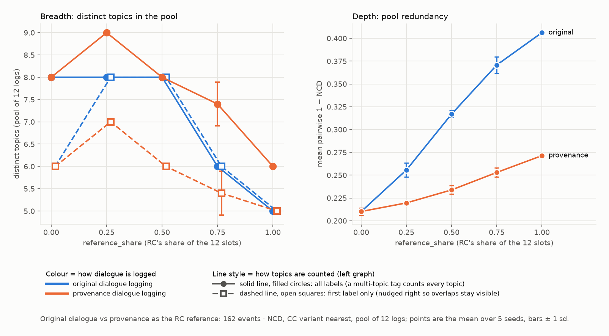
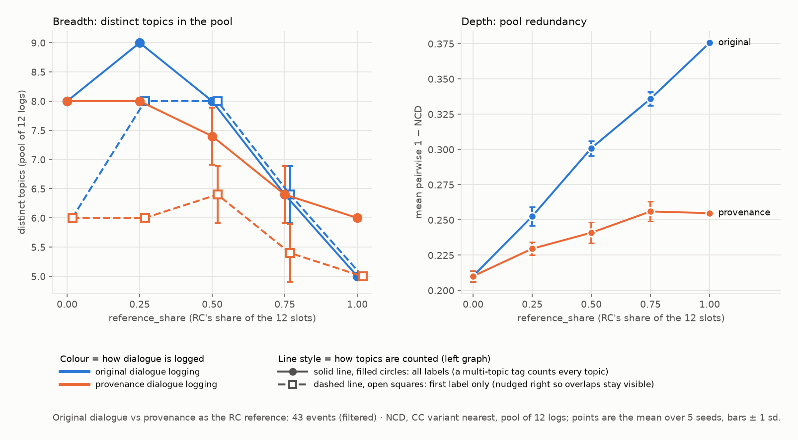

# Logging dialogue so the RC can match it: original vs stripped vs provenance

Dialogue is the RC reference the player actually sees, but it paraphrases the events it is about, so matching it against session-2 event logs is hard. This compares three ways of using the same 8 session-1 dialogue lines, scored against the same dialogue gold:

| logging | what the RC compares | game change needed |
|---|---|---|
| original | the line as logged: `Odette 'Odette' O'Neill said 'Stench, I watched the far treeline…'` | none |
| stripped | the line without the speech frame and vocative: `I watched the far treeline for more raiders.` | none (preprocessing) |
| provenance | the session-1 logs the line was generated from (best match over its sources); the pool and the player still get the dialogue line | log source `_ID_`s with each dialogue line |

Each is run with NCD and event indexing, over all 162 session-2 events and over the 43 the AC keeps after filtering. Session 2, AC, composer, total 12 and MMR λ 0.7 as in the other reports. No embeddings, no A2.

Sources used:

| line | source logs (session 1) |
|---|---|
| S104 | J784, J197 |
| S107 | L0, b57 |
| S110 | J11165, L0 |
| S111 | J19592, L5 |
| S105 | b74, b81 |
| S108 | b57, b88 |
| S112 | J197 |
| S106 | J6248, J784 |

## A1 — does the RC find the events the author says continue a dialogue line?

Recall@5 (pass ≥ 0.5) / MRR:

| logging | 162 events · NCD | 162 events · index | 43 events · NCD | 43 events · index |
|---|---|---|---|---|
| original | 0.10 / 0.20 | 0.23 / 0.37 | 0.00 / 0.09 | 0.22 / 0.27 |
| stripped | 0.07 / 0.18 | 0.23 / 0.42 | 0.12 / 0.30 | 0.22 / 0.32 |
| provenance | 0.57 / 0.65 | 0.47 / 0.81 | 0.65 / 0.74 | 0.74 / 0.72 |

Verdict:

| logging | 162 events · NCD | 162 events · index | 43 events · NCD | 43 events · index |
|---|---|---|---|---|
| original | fail | fail | fail | fail |
| stripped | fail | fail | fail | fail |
| provenance | pass | fail | pass | pass |

Rank of every gold event (out of 162), original dialogue vs provenance:

| line | gold event | original · NCD | provenance · NCD | provenance · index |
|---|---|---|---|---|
| S104 | E069 A(n) grizzly bear wandering. | 82 | 3 | 10 |
| S104 | E070 A(n) grizzly bear standing. | 83 | 1 | 7 |
| S104 | E088 Stench hauling steel x18 to Stockpile zone 1. | 49 | 2 | 1 |
| S104 | E153 A(n) grizzly bear consuming area. | 70 | 7 | 9 |
| S107 | E045 Boyd is wandering around in a psychotic state. This ha… | 22 | 2 | 7 |
| S110 | E000 Boyd watching for targets. | 77 | 1 | 16 |
| S110 | E001 Odette tending to Odette. | 73 | 3 | 1 |
| S111 | E007 A(n) gazelle wandering. | 92 | 14 | 2 |
| S111 | E008 A(n) gazelle standing. | 103 | 15 | 3 |
| S111 | E071 A(n) gazelle consuming grass. | 86 | 1 | 1 |
| S111 | E095 A medieval farm oaf named Ackmann is crashing in a tra… | 102 | 151 | 102 |
| S105 | E051 Stench shot at the turkey. | 66 | 7 | 6 |
| S105 | E055 A(n) turkey was afflicted with (a) gunshot (body) | 43 | 84 | 59 |
| S105 | E085 Stench burying Walrus, Treehouse builder (dead) in gra… | 5 | 36 | 1 |
| S108 | E084 Stench burying Anteater, Shaman (dead) in grave. | 29 | 27 | 3 |
| S108 | E085 Stench burying Walrus, Treehouse builder (dead) in gra… | 10 | 30 | 4 |
| S108 | E135 Stench missed Odette with a hit from her left fist. | 33 | 42 | 15 |
| S108 | E137 Odette attempted to hit Stench, but hesitated at the l… | 3 | 102 | 20 |
| S108 | E141 Odette hit Stench with her left fist. | 58 | 45 | 14 |
| S108 | E143 Stench tried to hit Odette, but missed. | 53 | 118 | 13 |
| S112 | E069 A(n) grizzly bear wandering. | 75 | 2 | 3 |
| S112 | E070 A(n) grizzly bear standing. | 76 | 1 | 1 |
| S112 | E153 A(n) grizzly bear consuming area. | 67 | 3 | 2 |
| S106 | E050 Stench leading Papyrus to wooden pen marker. | 34 | 25 | 10 |
| S106 | E086 Stench hauling wooden club to Stockpile zone 1. | 10 | 4 | 5 |
| S106 | E088 Stench hauling steel x18 to Stockpile zone 1. | 15 | 2 | 1 |
| S106 | E089 Stench hauling synthread pants (normal 97%) to Stockpi… | 1 | 8 | 7 |
| S106 | E090 Stench hauling silver x500 to Stockpile zone 1. | 25 | 3 | 3 |
| S106 | E091 Stench hauling component x30 to Stockpile zone 1. | 26 | 5 | 4 |
| S106 | E159 Stench hauling packaged survival meal x10 to Stockpile… | 4 | 7 | 6 |

## A3 — redundancy in what the RC picks (share 0.5, total 12)

Dialogue lines in the pool / CC redundancy (mean 1−NCD over pairs of CC events), for `nearest` (the game's selector) and the variant A3 picks by its rule:

| logging | set-up | `nearest` | A3's pick | A3 |
|---|---|---|---|---|
| original | 162 events · NCD | 1 / 0.50 | `mmr` 3 / 0.38 | pass |
| original | 162 events · index | 1 / 0.45 | `cap+mmr` 2 / 0.29 | fail |
| original | 43 events · NCD | 3 / 0.43 | `mmr` 3 / 0.35 | pass |
| original | 43 events · index | 1 / 0.40 | `cap+mmr` 2 / 0.31 | fail |
| stripped | 162 events · NCD | 2 / 0.45 | `mmr` 3 / 0.38 | pass |
| stripped | 162 events · index | 1 / 0.58 | `cap+mmr` 2 / 0.30 | fail |
| stripped | 43 events · NCD | 2 / 0.47 | `mmr` 3 / 0.38 | pass |
| stripped | 43 events · index | 1 / 0.39 | `cap+mmr` 2 / 0.32 | fail |
| provenance | 162 events · NCD | 3 / 0.26 | `cap` 3 / 0.30 | pass |
| provenance | 162 events · index | 3 / 0.26 | `mmr` 3 / 0.26 | pass |
| provenance | 43 events · NCD | 3 / 0.29 | `cap` 3 / 0.29 | pass |
| provenance | 43 events · index | 2 / 0.27 | `cap` 2 / 0.26 | fail |

## A4 — is the share a breadth/depth dial? (`nearest`)

Original dialogue vs provenance, with all 162 events and NCD. Left, breadth: solid lines count every topic of a multi-topic tag, dashed lines only its first (nudged slightly right so overlapping points stay visible). Right, depth: redundancy against the share.

The same with the 43 filtered candidates (the AC's cluster representatives):

| logging | set-up | ρ(share, topics) | first label | ρ(share, redundancy) | A4 |
|---|---|---|---|---|---|
| original | 162 events · NCD | -0.89 | -0.53 | 0.99 | pass |
| original | 162 events · index | -0.82 | -0.56 | 0.99 | partial |
| original | 43 events · NCD | -0.82 | -0.46 | 0.99 | pass |
| original | 43 events · index | -0.82 | -0.56 | 0.99 | partial |
| stripped | 162 events · NCD | -0.79 | 0.63 | 0.99 | pass |
| stripped | 162 events · index | -0.89 | -0.53 | 0.99 | partial |
| stripped | 43 events · NCD | -0.81 | 0.06 | 0.99 | pass |
| stripped | 43 events · index | -0.89 | -0.53 | 0.99 | pass |
| provenance | 162 events · NCD | -0.76 | -0.73 | 0.99 | pass |
| provenance | 162 events · index | -0.81 | -0.81 | 0.99 | pass |
| provenance | 43 events · NCD | -0.90 | -0.68 | 0.90 | pass |
| provenance | 43 events · index | -0.81 | -0.79 | 0.93 | pass |

## The pool at share 0.5 (`nearest`, seed 42), as the LLM would see it

`original · 162 events · NCD (the game today)`

| channel | description |
|---|---|
| CC (ref) | Odette 'Odette' O'Neill said 'Stench, I watched the far treeline for more raiders.' |
| AC | Boyd watching for targets. |
| AC | Stench, Hunter is fully healed. |
| AC | Boyd is wandering around in a psychotic state. This happened because of poor mood. The fi… |
| AC | Stench leading Papyrus to wooden pen marker. |
| AC | Stench missed the tortoise. |
| AC | Stench hauling silver x500 to Stockpile zone 1. |
| CC | Odette is no longer on an insulting spree against Stench, Hunter. |
| CC | Odette missed Stench with a beat from her left fist. |
| CC | Stench missed Odette with a smash from her left fist. |
| CC | Odette attempted to hit Stench, but hesitated at the last second. |
| CC | Stench flailed at Odette with her left fist, but stumbled at the last second. |

`provenance · 162 events · NCD`

| channel | description |
|---|---|
| CC (ref) | Lidia 'Stench' Schmitt said 'Boyd, I had those fifty-six steel beams stashed before the g… |
| CC (ref) | Odette 'Odette' O'Neill said 'Stench, those gazelles were grazing amid the chunks of the … |
| CC (ref) | Odette 'Odette' O'Neill said 'Boyd, a grizzly at camp's edge was trouble waiting to happe… |
| AC | Boyd watching for targets. |
| AC | Stench, Hunter is fully healed. |
| AC | Boyd is wandering around in a psychotic state. This happened because of poor mood. The fi… |
| AC | Stench leading Papyrus to wooden pen marker. |
| AC | Stench missed the tortoise. |
| CC | A(n) grizzly bear standing. |
| CC | A(n) gazelle consuming grass. |
| CC | Stench hauling steel x18 to Stockpile zone 1. |
| AC | Stench hauling silver x500 to Stockpile zone 1. |

`provenance · 162 events · event indexing`

| channel | description |
|---|---|
| CC (ref) | Lidia 'Stench' Schmitt said 'Boyd, I had those fifty-six steel beams stashed before the g… |
| CC (ref) | Odette 'Odette' O'Neill said 'Stench, those gazelles were grazing amid the chunks of the … |
| CC (ref) | Lidia 'Stench' Schmitt said 'Boyd, Papyrus trailed me all the way to Stockpile One.' |
| AC | Boyd watching for targets. |
| AC | Stench, Hunter is fully healed. |
| AC | Boyd is wandering around in a psychotic state. This happened because of poor mood. The fi… |
| CC | Papyrus following Stench. |
| AC | Stench leading Papyrus to wooden pen marker. |
| AC | Stench missed the tortoise. |
| CC | A(n) gazelle consuming grass. |
| CC | Stench hauling steel x18 to Stockpile zone 1. |
| AC | Stench hauling silver x500 to Stockpile zone 1. |

## Reading

- **Provenance solves the paraphrase problem, even with plain NCD.** Recall@5 goes from 0.10 to 0.57 (MRR 0.20 → 0.65) with the game's own measure, and to 0.65 with filtered candidates. Dialogue passes A1 for the first time, without embeddings. The player still sees the dialogue line; only what the RC matches changes.
- **It also fixes redundancy.** The treeline line no longer floods the pool with fight lines: its sources are *Odette watching for targets* and the raid, so `nearest` alone gives 3 dialogue lines and the joint-lowest CC redundancy of any dialogue set-up (3 / 0.26). The fights only came from matching on colonist names.
- **The share works as a dial with provenance, and more robustly.** A4 passes in all four provenance set-ups, and the first-label reading mostly holds too (ρ -0.73, -0.81, -0.68, -0.79), where original dialogue's pass rests on multi-topic tags (first label -0.53).
- **Event indexing helps the lines whose sources share entities but not wording.** The walrus lines find the walrus and anteater burials (rank 1–4 instead of 27–36 with NCD), but it misses lines where NCD's wording match is right (*Odette watching for targets* → *Boyd watching for targets*: 1 with NCD, 16 with indexing). With all 162 events it has the better MRR and Recall@10 and NCD the better Recall@5; with filtered candidates it is ahead on Recall@5 too (0.74 vs 0.65).
- **Stripping the speech frame doesn't help** (Recall@5 0.10 → 0.07 with NCD). Names were not the main obstacle; paraphrase was.
- **What it means for the game:** log the `_ID_`s of the pool logs each dialogue line was generated from, and let the RC match on those. The dialogue step currently works from the narrative, so it would need the pool logs too and return the source IDs with each line.

## Caveats

- The provenance is simulated by hand-mapping each line to session-1 logs; in the game it would come from the LLM, which could cite the wrong logs.
- The 8 lines were generated from the 13 logs the AC selected in session 1, so every source is one of those; this is close to the `s1_selected` reference, with the dialogue lines kept as the player-facing layer.
- One colony, two sessions, 8 dialogue lines, single author's gold and tags.

