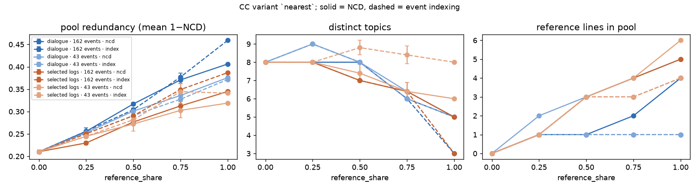

# CC similarity: NCD vs event indexing

The CC (game: RC) scores how close a session-2 event is to a reference line. The game uses **NCD** on the descriptions. **Event indexing** follows the event-indexing model of story comprehension (Zwaan, Langston & Graesser, 1995), where readers link events that share a protagonist, place, time, cause or goal. It combines four dimensions read from the logs' structured fields:

| dimension | what it measures | weight |
|---|---|---|
| entity | overlap of the entities involved: colonists, animals and other pawns from the `Actors` field and named in the text, each weighted by how rare it is in session 2 (IDF) | 0.4 |
| text | 1 − NCD on the descriptions (the existing measure) | 0.3 |
| place | exp(−distance / 25 cells) between map positions | 0.2 |
| type | same log tag (CL/JOB/ARC/HP), only with event references (dialogue is always SL) | 0.1 |

The weights are untuned defaults: with 8–13 reference lines, fitting them to the gold would overfit. Time and causality are not used: across sessions every reference line is "long ago", and the logs record no causes. No language model is involved.

Everything else matches `CANDIDATE_FILTER_COMPARISON.md`: session 2 = `SimulatedDay2`, AC at threshold 0.5 with `least_frequent`, the game's composer, total 12. No embeddings, no A2.

## At a glance

|  | dialogue · 162 events · ncd | dialogue · 162 events · index | dialogue · 43 events · ncd | dialogue · 43 events · index | selected logs · 162 events · ncd | selected logs · 162 events · index | selected logs · 43 events · ncd | selected logs · 43 events · index |
|---|---|---|---|---|---|---|---|---|
| A1 Recall@5 (pass ≥ 0.5) | 0.10 | 0.23 | 0.00 | 0.22 | 0.33 | 0.72 | 0.46 | 0.65 |
| A1 Recall@5, no exact repeats | – | – | – | – | 0.16 | 0.66 | 0.46 | 0.65 |
| A1 MRR | 0.20 | 0.37 | 0.09 | 0.27 | 0.40 | 0.68 | 0.43 | 0.54 |
| A1 verdict | fail | fail | fail | fail | fail | pass | fail | pass |
| A3 `nearest`: ref lines / CC redundancy | 1 / 0.50 | 1 / 0.45 | 3 / 0.43 | 1 / 0.40 | 3 / 0.30 | 3 / 0.26 | 3 / 0.29 | 3 / 0.32 |
| A3 `mmr`: ref lines / CC redundancy | 3 / 0.38 | 1 / 0.34 | 3 / 0.35 | 1 / 0.36 | 3 / 0.30 | 3 / 0.26 | 3 / 0.29 | 3 / 0.28 |
| A3 verdict | pass | fail | pass | fail | pass | pass | pass | pass |
| A4 ρ(share, topics) / first label | -0.89 / -0.53 | -0.82 / -0.56 | -0.82 / -0.46 | -0.82 / -0.56 | -0.96 / -0.96 | -0.96 / -0.96 | -0.90 / -0.90 | 0.13 / 0.13 |
| A4 verdict | pass | partial | pass | partial | pass | pass | pass | fail |

## A1 — does the CC find the events the author says continue a reference line?

| set-up | similarity | Recall@5 | Recall@10 | MRR | gold targets |
|---|---|---|---|---|---|
| dialogue · 162 events | ncd | 0.098 | 0.137 | 0.205 | 30 |
| dialogue · 162 events | index | 0.226 | 0.226 | 0.366 | 30 |
| dialogue · 43 events | ncd | 0.000 | 0.323 | 0.090 | 18 |
| dialogue · 43 events | index | 0.219 | 0.312 | 0.272 | 18 |
| selected logs · 162 events | ncd | 0.331 | 0.346 | 0.404 | 20 |
| selected logs · 162 events | index | 0.715 | 0.885 | 0.683 | 20 |
| selected logs · 43 events | ncd | 0.462 | 0.577 | 0.435 | 15 |
| selected logs · 43 events | index | 0.654 | 0.654 | 0.539 | 15 |

Rank of the best-ranked gold event per reference line, dialogue · 162 events (lower is better):

| line | reference text | NCD | event indexing |
|---|---|---|---|
| S104 | Lidia 'Stench' Schmitt said 'Boyd, I had those fifty-six steel beams st… | 49 | 31 |
| S107 | Dillon 'Boyd' Boyd said 'Stench, my hands shook when the raiders struck… | 22 | 3 |
| S110 | Odette 'Odette' O'Neill said 'Stench, I watched the far treeline for mo… | 73 | 31 |
| S111 | Odette 'Odette' O'Neill said 'Stench, those gazelles were grazing amid … | 86 | 58 |
| S105 | Lidia 'Stench' Schmitt said 'Boyd, my shot dropped that walrus in a spr… | 5 | 1 |
| S108 | Dillon 'Boyd' Boyd said 'Stench, I hit that walrus, then I stung the an… | 3 | 1 |
| S112 | Odette 'Odette' O'Neill said 'Boyd, a grizzly at camp's edge was troubl… | 67 | 63 |
| S106 | Lidia 'Stench' Schmitt said 'Boyd, Papyrus trailed me all the way to St… | 1 | 2 |

Rank of the best-ranked gold event per reference line, selected logs · 162 events (lower is better):

| line | reference text | NCD | event indexing |
|---|---|---|---|
| J197 | A(n) grizzly bear standing. | 1 | 1 |
| J784 | Stench hauling steel x56 to Stockpile zone 1. | 1 | 1 |
| J6248 | Papyrus following Stench. | 1 | 1 |
| J23595 | Stench moving. | 29 | 5 |
| L0 | A group of tribespeople from Confederacy of Loucó have arrived nearby. … | 23 | 1 |
| J11087 | Boyd relaxing socially. | 80 | 6 |
| J11165 | Odette watching for targets. | 1 | 15 |
| b57 | Boyd fired timidly at Walrus. | 23 | 1 |
| b74 | Stench hit Walrus with a shot. | 28 | 1 |
| b81 | Walrus died. | 104 | 1 |
| b88 | Boyd's shot hit Anteater. | 18 | 3 |
| J19592 | A(n) gazelle consuming grass. | 1 | 1 |
| L5 | Chunks of a spacecraft have impacted nearby. You can deconstruct them t… | 68 | 9 |

## A3 — redundancy in what the CC picks (share 0.5, total 12)

Each cell: reference lines in the pool / CC redundancy (mean 1−NCD over pairs of CC events; redundancy is measured with NCD in every set-up so the numbers stay comparable).

| variant | dialogue · 162 events · ncd | dialogue · 162 events · index | dialogue · 43 events · ncd | dialogue · 43 events · index | selected logs · 162 events · ncd | selected logs · 162 events · index | selected logs · 43 events · ncd | selected logs · 43 events · index |
|---|---|---|---|---|---|---|---|---|
| nearest | 1 / 0.50 | 1 / 0.45 | 3 / 0.43 | 1 / 0.40 | 3 / 0.30 | 3 / 0.26 | 3 / 0.29 | 3 / 0.32 |
| cap | 2 / 0.45 | 2 / 0.34 | 2 / 0.40 | 2 / 0.31 | 3 / 0.30 | 3 / 0.26 | 3 / 0.29 | 3 / 0.32 |
| mmr | 3 / 0.38 | 1 / 0.34 | 3 / 0.35 | 1 / 0.36 | 3 / 0.30 | 3 / 0.26 | 3 / 0.29 | 3 / 0.28 |
| cap+mmr | 3 / 0.38 | 2 / 0.29 | 3 / 0.35 | 2 / 0.31 | 3 / 0.30 | 3 / 0.26 | 3 / 0.29 | 3 / 0.28 |
| mmr_ix | – | 2 / 0.33 | – | 2 / 0.39 | – | 3 / 0.26 | – | 3 / 0.24 |
| cap+mmr_ix | – | 2 / 0.33 | – | 2 / 0.31 | – | 3 / 0.26 | – | 3 / 0.24 |

`mmr_ix` and `cap+mmr_ix` exist only with event indexing: MMR whose redundancy term uses the event-indexing similarity between two session-2 events (shared entities, place, log type, NCD text) instead of 1 − NCD, so relevance and redundancy are measured the same way.

### MMR's λ (relevance vs diversity), event indexing

Reference lines in the pool / CC redundancy at share 0.5. λ = 0.7 is the default used everywhere else; lower λ weighs diversity more.

| set-up | variant | λ 0.7 | λ 0.5 | λ 0.3 |
|---|---|---|---|---|
| dialogue · 162 events | mmr | 1 / 0.34 | 1 / 0.28 | 2 / 0.21 |
| dialogue · 162 events | cap+mmr | 2 / 0.29 | 2 / 0.23 | 2 / 0.21 |
| dialogue · 162 events | mmr_ix | 2 / 0.33 | 3 / 0.28 | 3 / 0.25 |
| dialogue · 162 events | cap+mmr_ix | 2 / 0.33 | 3 / 0.28 | 3 / 0.25 |
| dialogue · 43 events | mmr | 1 / 0.36 | 1 / 0.33 | 2 / 0.28 |
| dialogue · 43 events | cap+mmr | 2 / 0.31 | 2 / 0.24 | 2 / 0.24 |
| dialogue · 43 events | mmr_ix | 2 / 0.39 | 3 / 0.35 | 3 / 0.23 |
| dialogue · 43 events | cap+mmr_ix | 2 / 0.31 | 3 / 0.35 | 3 / 0.23 |
| selected logs · 162 events | mmr | 3 / 0.26 | 3 / 0.26 | 3 / 0.23 |
| selected logs · 162 events | cap+mmr | 3 / 0.26 | 3 / 0.26 | 3 / 0.23 |
| selected logs · 162 events | mmr_ix | 3 / 0.26 | 3 / 0.26 | 3 / 0.26 |
| selected logs · 162 events | cap+mmr_ix | 3 / 0.26 | 3 / 0.26 | 3 / 0.26 |
| selected logs · 43 events | mmr | 3 / 0.28 | 3 / 0.24 | 3 / 0.23 |
| selected logs · 43 events | cap+mmr | 3 / 0.28 | 3 / 0.24 | 3 / 0.23 |
| selected logs · 43 events | mmr_ix | 3 / 0.24 | 3 / 0.29 | 3 / 0.23 |
| selected logs · 43 events | cap+mmr_ix | 3 / 0.24 | 3 / 0.29 | 3 / 0.23 |

## A4 — is the share a breadth/depth dial?

| set-up | similarity | ρ(share, topics) | first label | ρ(share, redundancy) | A4 |
|---|---|---|---|---|---|
| dialogue · 162 events | ncd | -0.89 | -0.53 | 0.99 | pass |
| dialogue · 162 events | index | -0.82 | -0.56 | 0.99 | partial |
| dialogue · 43 events | ncd | -0.82 | -0.46 | 0.99 | pass |
| dialogue · 43 events | index | -0.82 | -0.56 | 0.99 | partial |
| selected logs · 162 events | ncd | -0.96 | -0.96 | 0.99 | pass |
| selected logs · 162 events | index | -0.96 | -0.96 | 0.99 | pass |
| selected logs · 43 events | ncd | -0.90 | -0.90 | 0.96 | pass |
| selected logs · 43 events | index | 0.13 | 0.13 | 0.93 | fail |

Distinct topics from share 0 to 1 (`nearest`):

| set-up | NCD | event indexing |
|---|---|---|
| dialogue · 162 events | 8.00 → 8.00 → 8.00 → 6.00 → 5.00 | 8.00 → 9.00 → 8.00 → 6.00 → 3.00 |
| dialogue · 43 events | 8.00 → 9.00 → 8.00 → 6.40 → 5.00 | 8.00 → 9.00 → 8.00 → 6.00 → 5.00 |
| selected logs · 162 events | 8.00 → 8.00 → 7.00 → 6.40 → 5.00 | 8.00 → 8.00 → 7.00 → 6.40 → 3.00 |
| selected logs · 43 events | 8.00 → 8.00 → 7.40 → 6.40 → 6.00 | 8.00 → 8.00 → 8.80 → 8.40 → 8.00 |

- **Selected logs, all events:** event indexing keeps the dial (ρ -0.96): at share 1 the CC fills the pool with hauling and animal events linked to the selected logs, and the topic count drops to 3.
- **Selected logs, filtered candidates:** the dial disappears (ρ 0.13): topics stay at 8–9 at every share while redundancy still rises. With one representative per cluster and links through entities and places, the CC reaches into different topics instead of repeating one. This fails A4's breadth/depth claim, but it is the only set-up where adding continuity doesn't cost breadth.
- **Dialogue:** `nearest` keeps a dial driven by the fight lines (topics fall to 3 with all events). The variant A3 picks now (`cap+mmr`) keeps breadth (7 topics at share 1) and misses the threshold (ρ -0.67), so A4 is only partial.

## The pool at share 0.5 (`nearest`, seed 42) with event indexing

`dialogue · 162 events`

| channel | description |
|---|---|
| CC (ref) | Odette 'Odette' O'Neill said 'Stench, I watched the far treeline for more raiders.' |
| AC | Boyd watching for targets. |
| AC | Stench, Hunter is fully healed. |
| AC | Boyd is wandering around in a psychotic state. This happened because of poor mood. T… |
| AC | Stench leading Papyrus to wooden pen marker. |
| AC | Stench missed the tortoise. |
| AC | Stench hauling silver x500 to Stockpile zone 1. |
| CC | Odette is no longer on an insulting spree against Stench, Hunter. |
| CC | Odette called Stench a salamander. This drove Stench into a rage and she began a fig… |
| CC | Odette missed Stench with a beat from her left fist. |
| CC | Odette attempted to hit Stench, but hesitated at the last second. |
| CC | Stench flailed at Odette with her left fist, but stumbled at the last second. |

`dialogue · 43 events`

| channel | description |
|---|---|
| CC (ref) | Odette 'Odette' O'Neill said 'Stench, I watched the far treeline for more raiders.' |
| AC | Boyd watching for targets. |
| AC | Stench, Hunter is fully healed. |
| AC | Boyd is wandering around in a psychotic state. This happened because of poor mood. T… |
| AC | Stench leading Papyrus to wooden pen marker. |
| AC | Stench missed the tortoise. |
| AC | Stench hauling silver x500 to Stockpile zone 1. |
| CC | Odette flagrantly insulted Stench's leg hair. |
| CC | Odette is no longer on an insulting spree against Stench, Hunter. |
| CC | Odette called Stench a salamander. This drove Stench into a rage and she began a fig… |
| CC | Stench missed Odette with a hit from her left fist. |
| CC | Odette tried to use her right fist to hit Stench, but stumbled at the last second. |

`selected logs · 162 events`

| channel | description |
|---|---|
| CC (ref) | Stench hauling steel x56 to Stockpile zone 1. |
| CC (ref) | Papyrus following Stench. |
| CC (ref) | A(n) gazelle consuming grass. |
| AC | Boyd watching for targets. |
| AC | Stench, Hunter is fully healed. |
| AC | Boyd is wandering around in a psychotic state. This happened because of poor mood. T… |
| CC | Papyrus following Stench. |
| AC | Stench leading Papyrus to wooden pen marker. |
| AC | Stench missed the tortoise. |
| CC | A(n) gazelle consuming grass. |
| CC | Stench hauling steel x18 to Stockpile zone 1. |
| AC | Stench hauling silver x500 to Stockpile zone 1. |

`selected logs · 43 events`

| channel | description |
|---|---|
| CC (ref) | Stench hauling steel x56 to Stockpile zone 1. |
| CC (ref) | Papyrus following Stench. |
| CC (ref) | Stench moving. |
| AC | Boyd watching for targets. |
| AC | Stench, Hunter is fully healed. |
| AC | Boyd is wandering around in a psychotic state. This happened because of poor mood. T… |
| CC | Papyrus following Stench. |
| AC | Stench leading Papyrus to wooden pen marker. |
| AC | Stench missed the tortoise. |
| CC | Stench cloudwatching. |
| CC | Stench hauling silver x500 to Stockpile zone 1. |
| AC | A medieval farm oaf named Ackmann is crashing in a transport pod nearby. If he survi… |

## Reading

- **With selected logs, event indexing is the best CC measure so far, and needs no language model.** Recall@5 rises from 0.33 to 0.72 with all events (0.16 → 0.66 without exact repeats) and from 0.46 to 0.65 with filtered candidates. Both pass A1. The gains are the links NCD couldn't make: the walrus shot and the walrus's death to the walrus burial (ranks 23/28/104 → 1), the tribal raid to the burials (23 → 1), the spacecraft chunks to the crashing pod (68 → 9). One line gets worse: *Odette watching for targets* (1 → 15), because the entity dimension now prefers events involving Odette over the *watching for targets* lines about Boyd and Stench.
- **With dialogue, event indexing finds more but concentrates the pool.** Recall@5 0.10 → 0.23 and MRR 0.20 → 0.37: the walrus lines now find the walrus and anteater burials. But the treeline line shares both of its colonists with every Odette–Stench fight event, so those score far above everything else and take every CC slot with `nearest` or MMR, even with filtered candidates. Only the per-line cap breaks this up (2 dialogue lines, CC redundancy down to 0.29 with cap+MMR). The protagonist dimension amplifies what NCD did with names.
- **MMR needs the same similarity for redundancy as for relevance.** Two people in a long fight produce many events with identical entities. With NCD redundancy, MMR can't push the CC off the fight lines (1 dialogue line at λ 0.7 and 0.5). With event-indexing redundancy (`mmr_ix`) it reaches 2 lines at λ 0.7 and all 3 at λ 0.5, without a hard cap. At the default λ 0.7 that is still one line short, so A3 still fails for dialogue. By NCD's measure the picks are about as redundant as plain MMR's (0.33 vs 0.34 with all events, 0.39 vs 0.36 with filtered candidates) because they still share colonist names, but they are different kinds of event: an insult spree ending, a punch, Stench tending Odette afterwards. With selected logs, `mmr_ix` gives the lowest redundancy with filtered candidates (0.24) and is the variant A3 picks there.
- **Psychology:** event indexing shifts the CC from repetition priming (surface overlap) towards the situation-model links readers use to keep a story coherent. With selected logs as the reference it still implements selection history (what was selected before biases what is selected now), but at the level of who, where and what kind of event rather than wording.

## Caveats

- One colony, two sessions, 8 and 13 reference lines, single author's gold and tags.
- The weights (0.4 / 0.3 / 0.2 / 0.1) and the place scale (25 cells) were set by hand, not fitted; other values may rank differently.
- The entity vocabulary comes from the `Actors` fields of both sessions. An entity that is never an actor (e.g. "raiders", "treeline") is invisible to the entity dimension.
- Dialogue lines' positions are where they were spoken, a weak cue for what they're about.
- With filtered candidates, A1 credits a representative for its whole cluster.

