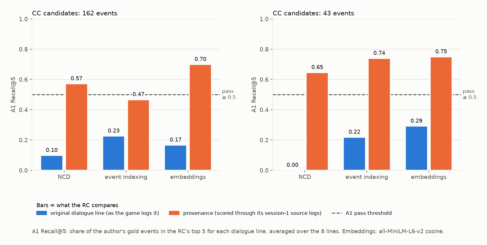
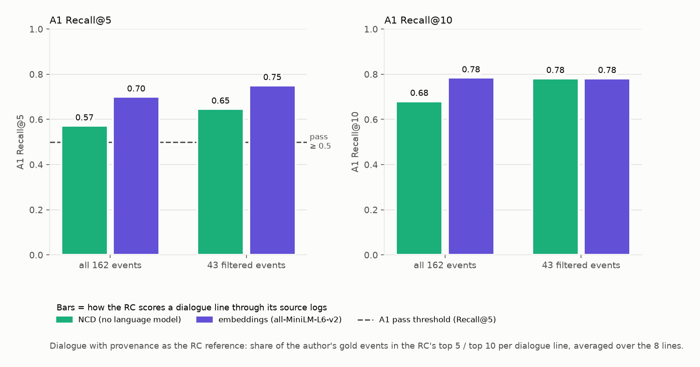

# Provenance vs embeddings for dialogue as the RC reference

Dialogue is the reference the player sees, but it paraphrases the events it is about. Two different fixes:

| fix | how | needs |
|---|---|---|
| **provenance** | the RC scores each dialogue line through the session-1 logs it was generated from; the pool still shows the line | the game logs the source `_ID_`s with each line; no language model |
| **embeddings** | a sentence-embedding model (all-MiniLM-L6-v2, cosine) scores the dialogue line itself, so a paraphrase can still match | no game change; a model trained on general English, run locally |

Crossing them: {original dialogue, provenance} × {NCD, event indexing, embeddings}, each over all 162 session-2 events and over the 43 the AC keeps after filtering. Same dialogue gold, AC, composer, total 12 and MMR λ 0.7 (MMR's redundancy term stays NCD in every run) as the other reports.

## A1 — 162 events: Recall@5 / Recall@10 / MRR (pass: Recall@5 ≥ 0.5)

| logging | NCD | event indexing | embeddings |
|---|---|---|---|
| original | 0.10 / 0.14 / 0.20 (fail) | 0.23 / 0.23 / 0.37 (fail) | 0.17 / 0.18 / 0.15 (fail) |
| provenance | 0.57 / 0.68 / 0.65 (pass) | 0.47 / 0.78 / 0.81 (fail) | 0.70 / 0.78 / 0.66 (pass) |

## A1 — 43 events: Recall@5 / Recall@10 / MRR (pass: Recall@5 ≥ 0.5)

| logging | NCD | event indexing | embeddings |
|---|---|---|---|
| original | 0.00 / 0.32 / 0.09 (fail) | 0.22 / 0.31 / 0.27 (fail) | 0.29 / 0.45 / 0.31 (fail) |
| provenance | 0.65 / 0.78 / 0.74 (pass) | 0.74 / 0.80 / 0.72 (pass) | 0.75 / 0.78 / 0.77 (pass) |

**Provenance with plain NCD finds far more than embeddings on the original line** (Recall@5 0.57 vs 0.17 with all events; 0.65 vs 0.29 filtered). Embeddings on top of provenance add a little more (0.70 and 0.75), about as much as event indexing does with filtered candidates (0.74).

With provenance only, NCD vs embeddings on Recall@5 and Recall@10:

Rank of the best-ranked gold event per dialogue line (all 162 events; lower is better):

| line | dialogue | original · embeddings | provenance · NCD | provenance · event indexing | provenance · embeddings |
|---|---|---|---|---|---|
| S104 | Lidia 'Stench' Schmitt said 'Boyd, I had those fifty-six st… | 11 | 1 | 1 | 1 |
| S107 | Dillon 'Boyd' Boyd said 'Stench, my hands shook when the ra… | 2 | 2 | 7 | 4 |
| S110 | Odette 'Odette' O'Neill said 'Stench, I watched the far tre… | 31 | 1 | 1 | 1 |
| S111 | Odette 'Odette' O'Neill said 'Stench, those gazelles were g… | 50 | 1 | 1 | 1 |
| S105 | Lidia 'Stench' Schmitt said 'Boyd, my shot dropped that wal… | 4 | 7 | 1 | 2 |
| S108 | Dillon 'Boyd' Boyd said 'Stench, I hit that walrus, then I … | 13 | 27 | 3 | 15 |
| S112 | Odette 'Odette' O'Neill said 'Boyd, a grizzly at camp's edg… | 22 | 1 | 1 | 1 |
| S106 | Lidia 'Stench' Schmitt said 'Boyd, Papyrus trailed me all t… | 6 | 2 | 1 | 2 |

## A3 and A4

A3: dialogue lines in the pool / CC redundancy at share 0.5. A4: ρ(share, topics) with `nearest`, all labels / first label (pass ≤ −0.7).

| logging | candidates | similarity | A3 `nearest` | A3's pick | A3 | A4 ρ | A4 |
|---|---|---|---|---|---|---|---|
| original | 162 events | NCD | 1 / 0.50 | `mmr` 3 / 0.38 | pass | -0.89 / -0.53 | pass |
| original | 162 events | event indexing | 1 / 0.45 | `cap+mmr` 2 / 0.29 | fail | -0.82 / -0.56 | partial |
| original | 162 events | embeddings | 3 / 0.29 | `cap` 3 / 0.29 | pass | -0.61 / 0.04 | fail |
| original | 43 events | NCD | 3 / 0.43 | `mmr` 3 / 0.35 | pass | -0.82 / -0.46 | pass |
| original | 43 events | event indexing | 1 / 0.40 | `cap+mmr` 2 / 0.31 | fail | -0.82 / -0.56 | partial |
| original | 43 events | embeddings | 3 / 0.35 | `mmr` 3 / 0.27 | pass | -0.82 / -0.46 | pass |
| provenance | 162 events | NCD | 3 / 0.26 | `cap` 3 / 0.30 | pass | -0.76 / -0.73 | pass |
| provenance | 162 events | event indexing | 3 / 0.26 | `mmr` 3 / 0.26 | pass | -0.81 / -0.81 | pass |
| provenance | 162 events | embeddings | 3 / 0.26 | `cap` 3 / 0.30 | pass | -0.83 / -0.83 | partial |
| provenance | 43 events | NCD | 3 / 0.29 | `cap` 3 / 0.29 | pass | -0.90 / -0.68 | pass |
| provenance | 43 events | event indexing | 2 / 0.27 | `cap` 2 / 0.26 | fail | -0.81 / -0.79 | pass |
| provenance | 43 events | embeddings | 2 / 0.27 | `cap` 2 / 0.27 | fail | -0.89 / -0.81 | pass |

## Reading

- **Provenance is the bigger lever.** Moving from the original line to its source logs raises Recall@5 for every measure (NCD 0.10 → 0.57, embeddings 0.17 → 0.70). Changing the measure on the original line helps much less (best: embeddings with filtered candidates, 0.29).
- **Embeddings do avoid the name flooding.** On the original dialogue, `nearest` with embeddings already spreads over 3 dialogue lines (NCD: 1), because a sentence model doesn't weigh shared colonist names the way a compressor does. But that alone doesn't make the matches right:
- **Embeddings alone don't solve the paraphrase problem here.** On the original dialogue they fail A1 in both candidate sets. A small general-English model doesn't know that "I hit that walrus" is about a tribesperson called Walrus (its best gold event, the burial, ranks 13), nor that the gazelles and the grizzly in the dialogue are the game's animals logged under those names (ranks 50 and 22).
- **With provenance, the measure matters less.** NCD, event indexing and embeddings all pass or come close; with all events embeddings are ahead on Recall@5 and event indexing on MRR. The source logs share the game's own vocabulary with the session-2 events, so even a compression measure works.
- **Embeddings on the original dialogue give no dial** (A4 with all events: ρ -0.61, first label 0.04): the model spreads its picks across topics, which avoids flooding but leaves breadth flat until share 0.75. With provenance the dial returns for `nearest`.
- **For the paper:** with filtered candidates, provenance with event indexing is within 0.01 of embeddings on Recall@5 (0.74 vs 0.75) without any language model. With all events, NCD trails embeddings on Recall@5 (0.57 vs 0.70) but ties on MRR (0.65 vs 0.66), and event indexing has the best MRR of all (0.81). That supports dropping embeddings for domain generalisation, provided the game logs provenance.

## Caveats

- One colony, 8 dialogue lines, single author's gold; provenance is hand-mapped (the game would get it from the LLM, which could cite the wrong logs).
- One embedding model, no tuning; a larger or domain-tuned model could do better on the original lines.
- MMR's redundancy term uses NCD in every run here, including the embedding runs.

