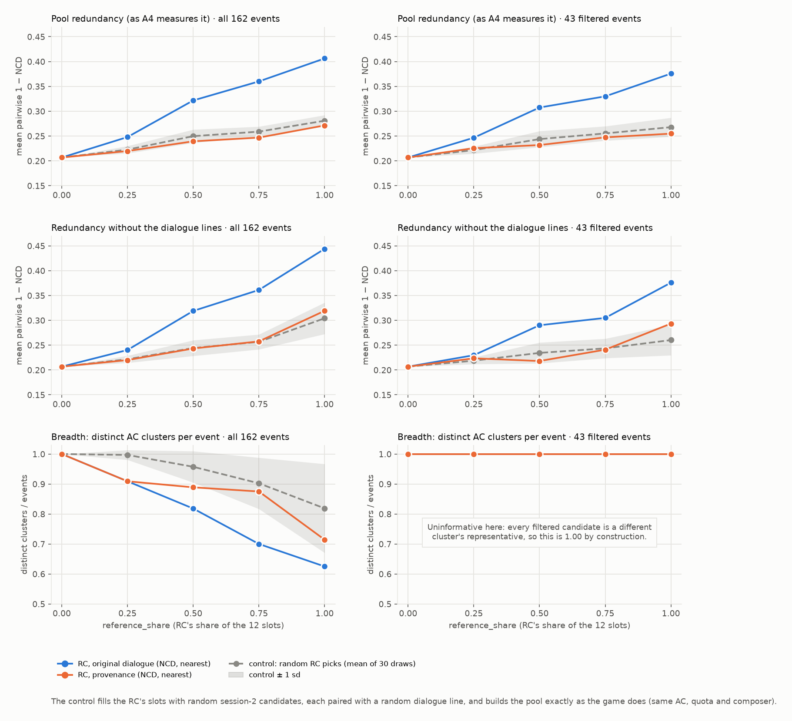

# Random-pick control for the breadth/depth dial

**Question (reviewer feedback):** redundancy may rise with the share partly by construction. More RC slots means more events picked for being similar to something, and each RC pair also brings a dialogue line into the pool. Does redundancy still rise when the RC's slots are filled with random session-2 events? If it does, the "dial" is how the pool is built, not the RC's doing.

**Control:** the RC's slots are filled with random session-2 candidates, each paired with a random dialogue line, and the pool is composed exactly as the game does: same AC (seed 42), quota (2 × round(12 × share) + 2 pairs) and composer. There are 30 random draws per share. It is compared with the RC as the game runs it (`nearest`, NCD) for the original dialogue and for provenance.

Produced by `python -m experiments.pilot.random_control`; numbers in `random_control.json`.

## Numbers (all 162 events)

| share | 0 | 0.25 | 0.5 | 0.75 | 1 |
|---|---|---|---|---|---|
| **pool redundancy** · original dialogue | 0.21 | 0.25 | 0.32 | 0.36 | 0.41 |
| · provenance | 0.21 | 0.22 | 0.24 | 0.25 | 0.27 |
| · random control | 0.21 | 0.22 | 0.25 | 0.26 | 0.28 |
| **without dialogue lines** · original dialogue | 0.21 | 0.24 | 0.32 | 0.36 | 0.44 |
| · provenance | 0.21 | 0.22 | 0.24 | 0.26 | 0.32 |
| · random control | 0.21 | 0.22 | 0.24 | 0.26 | 0.30 (± 0.03) |
| **clusters per event** · original dialogue | 1.00 | 0.91 | 0.82 | 0.70 | 0.62 |
| · provenance | 1.00 | 0.91 | 0.89 | 0.88 | 0.71 |
| · random control | 1.00 | 1.00 | 0.96 | 0.90 | 0.82 (± 0.15) |

With the 43 filtered events: pool redundancy at share 1 is 0.38 for original dialogue, 0.26 for provenance and 0.27 for the control. Clusters per event is 1.00 everywhere by construction, because every filtered candidate is a different cluster's representative.

**Breadth measure:** "clusters per event" is the number of distinct AC clusters (NCD 0.5) among the pool's session-2 events, divided by the number of events. It needs no topic tags, so it works for random picks too. It is normalised because every RC pair puts a dialogue line in the pool, which leaves fewer slots for events: raw counts fall even for random picks (12 → 6 clusters).

## What it shows

1. **The feedback is right: part of the rise is construction.** Random picks alone raise pool redundancy from 0.21 to 0.28. The AC deliberately picks rare, mutually different logs, so replacing *any* of its slots with ordinary session-2 events, which are mostly routine jobs, raises redundancy.
2. **The original dialogue's RC goes well beyond construction.** Redundancy reaches 0.41 (0.44 without dialogue lines) against 0.28–0.30 for random picks, and breadth falls to 0.62 clusters per event against 0.82. That narrowing is the RC's doing: the name-driven fight lines.
3. **Provenance's RC is at the random level for redundancy.** Its pools are as redundant as random ones at every share (0.27 vs 0.28 at share 1; with filtered candidates 0.26 vs 0.27). Breadth matches random up to share 0.75 (0.88 vs 0.90) and falls below it only at share 1 (0.71 vs 0.82, within the control's spread of ± 0.15).
4. **So for provenance, the depth "dial" is mostly construction.** The RC picks connected events (A1 passes) without adding redundancy beyond chance. For the game that's a good property: continuity without narrowing the story. But the share then can't be claimed as a depth dial driven by the RC.

## How far from random? (empirical test, 200 random draws)

The real RC's pool was compared with 200 random-pick pools at each share. p is the share of random pools at least as redundant as the RC's, or, for breadth, at least as narrow (+1 smoothing, so 0.005 is the smallest possible value).

| | share | pool redundancy | without dialogue | clusters per event |
|---|---|---|---|---|
| original · 162 events | 0.5 / 0.75 / 1 | p ≤ 0.005 at all three | p ≤ 0.005 at all three | p 0.045 / 0.030 / 0.12 |
| original · 43 events | 0.5 / 0.75 / 1 | p ≤ 0.005 at all three | p ≤ 0.005 at all three | n/a (1.00 by construction) |
| provenance · 162 events | 0.5 / 0.75 / 1 | p 0.84 / 0.90 / 0.71 | p 0.61 / 0.51 / 0.20 | p 0.24 / 0.42 / 0.24 |
| provenance · 43 events | 0.5 / 0.75 / 1 | p 0.83 / 0.75 / 0.85 | p 0.83 / 0.61 / 0.13 | n/a |

- **Original dialogue's redundancy is the RC's doing:** no random pool reaches it.
- **Its narrowing of breadth is weaker evidence:** p 0.03–0.12, because random breadth varies a lot.
- **Provenance can't be told apart from random picks** on either measure.

Two qualifications:
- **Scope:** this tests the RC's choices *on this corpus* (one colony, one deterministic RC run per share), not how the result generalises to other colonies.
- **What drives it:** the original dialogue's extra redundancy is real but comes from the wrong thing: name-driven fight lines, while A1 fails (Recall@5 0.10). It is depth without continuity. Provenance is the reverse: continuity (A1 0.57–0.65) without extra depth.

## Consequences

- **Report the RC's effect relative to the control:** actual minus random, not the raw trend. A4 should be redefined that way. Under that definition, original dialogue "narrows" strongly (for the wrong reason), and provenance barely narrows.
- **The earlier A4 results overstate the dial.** The raw ρ(share, redundancy) ≈ 0.99 holds for random picks too. Topic-based A4 results should also be checked against a random control; that needs topic tags for the randomly picked events, so here a tag-free breadth measure is used instead.
- **For the paper,** a defensible claim is that the share controls how much of the pool is continuity material. With provenance, that material is relevant (A1) and no more redundant than chance. That's a different and arguably better claim than a breadth/depth dial.

## Caveats

- One colony, two sessions; the real RC is deterministic (AC seed 42), so only the control has a spread.
- The control draws from the same candidate set as the RC (162 or 43), so its pools have the same dialogue-line share; it isolates *which* events the RC picks.
- Redundancy is NCD-based, so it measures shared wording; two events can be about the same thing and still score as different.
