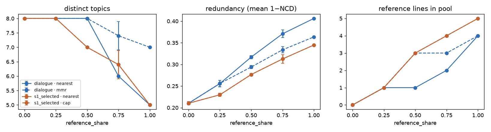

# CC reference sets compared: session-1 dialogue vs session-1 selected logs

Same session 2 (`SimulatedDay2`, 162 distinct events), same AC (threshold 0.5, `least_frequent`), same NCD order (event first, as in the game), same composer (port of the game's, total 12). Only the CC reference set changes:

|  | dialogue | s1_selected |
|---|---|---|
| what | lines colonists spoke in session 1 | the 13 logs the AC picked in session 1 |
| file | `SimulatedDay2/dialogue_logs.txt` | `SimulatedDay1/selected_reference_logs.txt` |
| reference lines | 8 | 13 |
| gold pairs (author) | 30 | 20 |
| gold pairs that are exact repeats | 0 | 3 |

## At a glance

| test | dialogue | s1_selected |
|---|---|---|
| A1 NCD Recall@5 (pass ≥ 0.5) | 0.10 | 0.33 |
| A1 embedding Recall@5 | 0.17 | 0.64 |
| A1 verdict | fail (both methods) | NCD fails, embeddings pass |
| A3 best variant | `mmr` | `cap` (all variants tie) |
| A4 ρ(share, topics) (pass ≤ −0.7) | `nearest` ρ -0.89 (first label -0.53); `mmr` ρ -0.79 (first label 0.15) | `nearest` ρ -0.96 (first label -0.96); `cap` ρ -0.96 (first label -0.96) |
| Decision rule | both A1 methods fail → rethink CC | NCD fails only → commit with embedding-based CC |

## A1 — does the CC find what the author says continues?

| reference | method | Recall@5 | Recall@10 | MRR |
|---|---|---|---|---|
| dialogue | ncd | 0.098 | 0.137 | 0.205 |
| dialogue | embedding | 0.167 | 0.185 | 0.148 |
| s1_selected | ncd | 0.331 | 0.346 | 0.404 |
| s1_selected | embedding | 0.638 | 0.654 | 0.491 |
| s1_selected, no exact repeats | ncd | 0.164 | 0.182 | 0.211 |
| s1_selected, no exact repeats | embedding | 0.573 | 0.591 | 0.338 |

The two gold sets were written separately for different reference lines, so the numbers compare how findable each kind of continuity is, not the same items.

Best-ranked gold event per reference line, `dialogue`:

| line | reference text | NCD | embedding |
|---|---|---|---|
| S104 | Lidia 'Stench' Schmitt said 'Boyd, I had those fifty-six steel beams … | 49 | 11 |
| S107 | Dillon 'Boyd' Boyd said 'Stench, my hands shook when the raiders stru… | 22 | 2 |
| S110 | Odette 'Odette' O'Neill said 'Stench, I watched the far treeline for … | 73 | 31 |
| S111 | Odette 'Odette' O'Neill said 'Stench, those gazelles were grazing ami… | 86 | 50 |
| S105 | Lidia 'Stench' Schmitt said 'Boyd, my shot dropped that walrus in a s… | 5 | 4 |
| S108 | Dillon 'Boyd' Boyd said 'Stench, I hit that walrus, then I stung the … | 3 | 13 |
| S112 | Odette 'Odette' O'Neill said 'Boyd, a grizzly at camp's edge was trou… | 67 | 22 |
| S106 | Lidia 'Stench' Schmitt said 'Boyd, Papyrus trailed me all the way to … | 1 | 6 |

Best-ranked gold event per reference line, `s1_selected`:

| line | reference text | NCD | embedding |
|---|---|---|---|
| J197 | A(n) grizzly bear standing. | 1 | 1 |
| J784 | Stench hauling steel x56 to Stockpile zone 1. | 1 | 1 |
| J6248 | Papyrus following Stench. | 1 | 1 |
| J23595 | Stench moving. | 29 | 4 |
| L0 | A group of tribespeople from Confederacy of Loucó have arrived nearby… | 23 | 91 |
| J11087 | Boyd relaxing socially. | 80 | 5 |
| J11165 | Odette watching for targets. | 1 | 3 |
| b57 | Boyd fired timidly at Walrus. | 23 | 24 |
| b74 | Stench hit Walrus with a shot. | 28 | 2 |
| b81 | Walrus died. | 104 | 1 |
| b88 | Boyd's shot hit Anteater. | 18 | 106 |
| J19592 | A(n) gazelle consuming grass. | 1 | 1 |
| L5 | Chunks of a spacecraft have impacted nearby. You can deconstruct them… | 68 | 23 |

**NCD concatenation order** (event-first vs dialogue-first): mean top-5 overlap per reference line 68% with dialogue vs 82% with selected logs. Short event lines against event lines are much less sensitive to the order than dialogue against events.

## A2 — does NCD match on names?

Colonist names masked on both sides; top-k = 6 CC slots (share 0.5, total 12). `per_colonist`: each colonist becomes their own token (C1, C2, …). `single`: every colonist becomes `C`. `removed`: names are deleted, so the two-person "C … C" shape is gone too.

| reference | masking | top-k pairs changed | actor match in top-k | top-5 overlap per line | NCD Recall@5 | NCD MRR |
|---|---|---|---|---|---|---|
| dialogue | unmasked | – | 100% | 1.00 | 0.10 | 0.20 |
| dialogue | per_colonist | 67% | 100% | 0.50 | 0.07 | 0.20 |
| dialogue | single | 83% | 100% | 0.42 | 0.07 | 0.20 |
| dialogue | removed | 83% | 100% | 0.45 | 0.06 | 0.22 |
| s1_selected | unmasked | – | 33% | 1.00 | 0.33 | 0.40 |
| s1_selected | per_colonist | 0% | 33% | 0.63 | 0.33 | 0.41 |
| s1_selected | single | 0% | 33% | 0.66 | 0.33 | 0.40 |
| s1_selected | removed | 0% | 33% | 0.63 | 0.33 | 0.40 |

With dialogue, masking reshuffles the top pairs (most change) but they are still mostly the Odette–Stench fight lines, and retrieval of the gold events doesn't improve: names steer which events win, but removing them doesn't reveal the intended matches. With selected logs, the top pairs don't change at all: they are exact or near-exact repeats, which match with or without names. Deeper in the ranking about a third of each line's top 5 still changes, without moving Recall@5.

Removing the names outright (`removed`) gives about the same picture as `single` for dialogue: the top pairs still share a colonist with the reference line, so the two-person "C … C" shape wasn't what kept them there. Some masked pairs move on-topic (the walrus shot → the rifle-shot lines; Papyrus to Stockpile One → hauling to Stockpile zone 1). Note that 41% of all dialogue × event combinations share a colonist by chance, mostly Stench, so a high actor match is weaker evidence than it looks.

Interpreting the masked pairs (on-topic / nonsense / unchanged) is still on hold for the author; the pair lists are in each run's `a2_report.md`.

## A3 — redundancy control (share 0.5, total 12)

| variant | dialogue: ref lines | dialogue: CC redundancy | s1_selected: ref lines | s1_selected: CC redundancy |
|---|---|---|---|---|
| nearest | 1 | 0.50 | 3 | 0.30 |
| cap | 2 | 0.45 | 3 | 0.30 |
| mmr | 3 | 0.38 | 3 | 0.30 |
| cap+mmr | 3 | 0.38 | 3 | 0.30 |

With dialogue, `nearest` lets one line (S110) take every CC slot with near-duplicate fight lines, and MMR spreads the slots over 3 lines. With selected logs, every variant already picks 3 different lines: each reference line's best match is an exact or near-exact repeat with NCD below 0.1, far ahead of everything else, so there is nothing for cap or MMR to fix.

## A4 — is the share a breadth/depth dial?

`dialogue` · `nearest`

| share | distinct topics | first-label topics | redundancy | ref lines | AC–CC overlap |
|---|---|---|---|---|---|
| 0.0 | 8.00 | 6.00 | 0.21 | 0.00 | 0.00 |
| 0.25 | 8.00 | 8.00 | 0.26 | 1.00 | 0.00 |
| 0.5 | 8.00 | 8.00 | 0.32 | 1.00 | 0.00 |
| 0.75 | 6.00 | 6.00 | 0.37 | 2.00 | 0.00 |
| 1.0 | 5.00 | 5.00 | 0.41 | 4.00 | 0.00 |

`dialogue` · `mmr`

| share | distinct topics | first-label topics | redundancy | ref lines | AC–CC overlap |
|---|---|---|---|---|---|
| 0.0 | 8.00 | 6.00 | 0.21 | 0.00 | 0.00 |
| 0.25 | 8.00 | 8.00 | 0.26 | 1.00 | 0.40 |
| 0.5 | 8.00 | 8.00 | 0.29 | 3.00 | 1.00 |
| 0.75 | 7.40 | 7.40 | 0.33 | 3.00 | 1.40 |
| 1.0 | 7.00 | 7.00 | 0.36 | 4.00 | 3.00 |

`s1_selected` · `nearest`

| share | distinct topics | first-label topics | redundancy | ref lines | AC–CC overlap |
|---|---|---|---|---|---|
| 0.0 | 8.00 | 6.00 | 0.21 | 0.00 | 0.00 |
| 0.25 | 8.00 | 6.00 | 0.23 | 1.00 | 3.00 |
| 0.5 | 7.00 | 5.00 | 0.28 | 3.00 | 4.00 |
| 0.75 | 6.40 | 4.40 | 0.31 | 4.00 | 4.00 |
| 1.0 | 5.00 | 3.00 | 0.34 | 5.00 | 4.00 |

`s1_selected` · `cap`

| share | distinct topics | first-label topics | redundancy | ref lines | AC–CC overlap |
|---|---|---|---|---|---|
| 0.0 | 8.00 | 6.00 | 0.21 | 0.00 | 0.00 |
| 0.25 | 8.00 | 6.00 | 0.23 | 1.00 | 3.00 |
| 0.5 | 7.00 | 5.00 | 0.28 | 3.00 | 4.00 |
| 0.75 | 6.40 | 4.40 | 0.31 | 4.00 | 4.60 |
| 1.0 | 5.00 | 3.00 | 0.34 | 5.00 | 5.00 |

With dialogue, the topic count is flat up to share 0.5 and its drop rests on the multi-topic "watching for targets" tags; counting first labels only, it fails. With selected logs it falls steadily under both readings. In both, redundancy rises steadily with share (ρ ≈ 0.99).

**AC–CC overlap** (CC candidate events that the AC also returned) at share 0.5 with `nearest`: 0.00 with dialogue vs 4.00 with selected logs. With dialogue the channels only overlap once MMR pushes the CC away from the fight lines.

## The pool at share 0.5 (`nearest`, seed 42), as the LLM would see it

`dialogue`

| channel | description |
|---|---|
| CC (ref) | Odette 'Odette' O'Neill said 'Stench, I watched the far treeline for more raiders.' |
| AC | Boyd watching for targets. |
| AC | Stench, Hunter is fully healed. |
| AC | Boyd is wandering around in a psychotic state. This happened because of poor mood. T… |
| AC | Stench leading Papyrus to wooden pen marker. |
| AC | Stench missed the tortoise. |
| AC | Stench hauling silver x500 to Stockpile zone 1. |
| CC | Odette is no longer on an insulting spree against Stench, Hunter. |
| CC | Odette missed Stench with a beat from her left fist. |
| CC | Stench missed Odette with a smash from her left fist. |
| CC | Odette attempted to hit Stench, but hesitated at the last second. |
| CC | Stench flailed at Odette with her left fist, but stumbled at the last second. |

`s1_selected`

| channel | description |
|---|---|
| CC (ref) | A(n) grizzly bear standing. |
| CC (ref) | Papyrus following Stench. |
| CC (ref) | A(n) gazelle consuming grass. |
| AC | Boyd watching for targets. |
| AC | Stench, Hunter is fully healed. |
| AC | Boyd is wandering around in a psychotic state. This happened because of poor mood. T… |
| CC | Papyrus following Stench. |
| AC | Stench leading Papyrus to wooden pen marker. |
| AC | Stench missed the tortoise. |
| CC | A(n) grizzly bear standing. |
| CC | A(n) gazelle consuming grass. |
| AC | Stench hauling silver x500 to Stockpile zone 1. |

With selected logs, half the pool is three descriptions written twice: each session-1 log and its exact session-2 repeat both enter, because the game's composer removes duplicates by `_ID_`, not by text. The in-game F11 would do the same with this reference file.

## Reading

- **Selected logs are easier to match, but much of what's matched is repetition.** Embeddings reach Recall@5 0.64 with selected logs (0.57 without exact repeats) and 0.17 with dialogue. NCD fails with both; with selected logs it mostly finds exact or near-exact repeats (0.33, falling to 0.16 without them).
- **Dialogue continuity is the harder and more interesting signal.** The dialogue lines paraphrase events ("I watched the far treeline for more raiders"), so neither method connects them to session-2 events reliably; NCD falls back to matching colonist names.
- **The dial works more cleanly with selected logs**, but partly because the CC fills the pool with repeats of topics the AC already covers (animals, hauling), which lowers breadth by construction.
- **The CC mechanics differ with the reference.** Redundancy control matters for dialogue and is moot for selected logs; deduplicating by text would matter for selected logs and is moot for dialogue.

## Caveats

- One colony, two sessions, 8 and 13 reference lines: very small samples, single author's gold and tags.
- Reference lines count against the CC quota, so at share 0.5 at most 3 can contribute in either set.
- Selected-log reference lines carry count `[x1]`: the session-1 counts (e.g. `[x179]` for the grizzly) were dropped when the file was written.
- Seeds only affect the AC and barely change it, so the ± over seeds understates variability.

