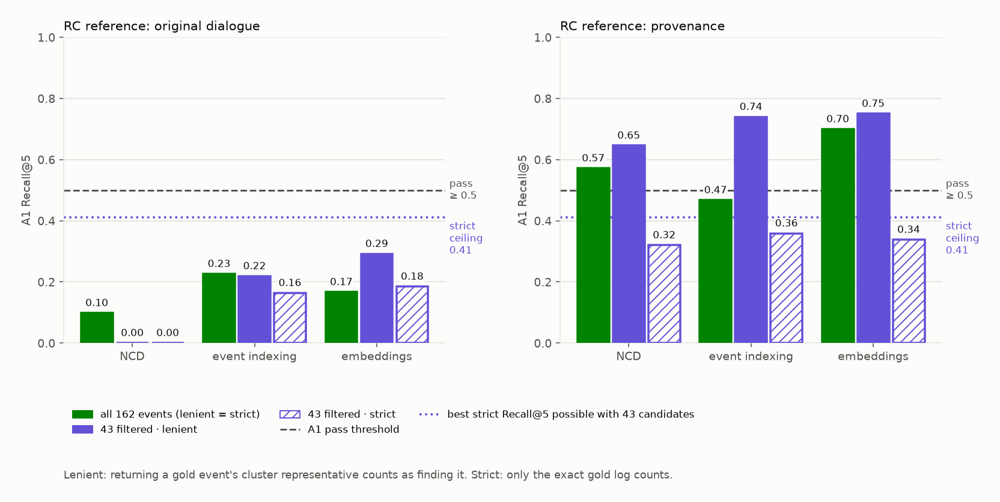

# A1 under strict scoring

**Review point:** with filtered candidates the pilot scored leniently. If the RC returns representative Y and gold event X is in Y's cluster, X counts as found. **Strict scoring** counts a hit only when the returned log *is* the gold event. With all 162 events every gold event can be returned itself, so the two scorings only differ with the 43 filtered candidates.

## A1 Recall@5 (pass ≥ 0.5)

| reference | similarity | 162 events | 43 · lenient | 43 · strict | MRR 43: lenient → strict |
|---|---|---|---|---|---|
| original dialogue | NCD | 0.10 (fail) | 0.00 (fail) | 0.00 (fail) | 0.09 → 0.07 |
| original dialogue | event indexing | 0.23 (fail) | 0.22 (fail) | 0.16 (fail) | 0.27 → 0.25 |
| original dialogue | embeddings | 0.17 (fail) | 0.29 (fail) | 0.18 (fail) | 0.31 → 0.18 |
| provenance | NCD | 0.57 (pass) | 0.65 (pass) | 0.32 (fail) | 0.74 → 0.62 |
| provenance | event indexing | 0.47 (fail) | 0.74 (pass) | 0.36 (fail) | 0.72 → 0.52 |
| provenance | embeddings | 0.70 (pass) | 0.75 (pass) | 0.34 (fail) | 0.77 → 0.58 |

**Ceiling:** only 10 of the 30 gold events are among the 43 representatives, so even a perfect RC would reach at most Recall@5 0.41 (Recall@10 0.41) under strict scoring. Every dialogue line has at least one reachable gold event.

## What it shows

- **Strict scoring roughly halves recall with filtered candidates.** Provenance falls from 0.65–0.75 to 0.32–0.36, below the pass threshold.
- **But the threshold is out of reach by construction.** The strict ceiling is 0.41. Relative to it, provenance gets 78%–87% of what is possible, so it still ranks the reachable gold events well. MRR also drops less than recall (NCD 0.74 → 0.62): the first hit usually stays near the top.
- **With all 162 events, scoring doesn't matter and provenance passes** with NCD (0.57) and embeddings (0.70); event indexing (0.47) is just short.
- **The lenient A1 advantage of filtering is a scoring artefact.** Filtering raised lenient Recall@5 (NCD 0.57 → 0.65); strictly it lowers it (0.32).

## Consequence for the implementation steps

- **Step 2 (43 filtered candidates by default) should be revisited.** Its A1 gain doesn't hold under strict scoring. Its other benefit, lower redundancy, mattered for the original dialogue. With provenance, though, redundancy is already at the random level with all 162 events (`RANDOM_CONTROL.md`).
- **Revised recommendation:** with provenance, let the RC pick from **all** events by default. Keep filtering as an option for long sessions, where comparing against thousands of distinct logs gets expensive, and score it strictly when it's used.
- **For the paper:** report strict scoring as the main A1 number, with lenient as a secondary reading, and state the ceiling whenever candidates are filtered.

