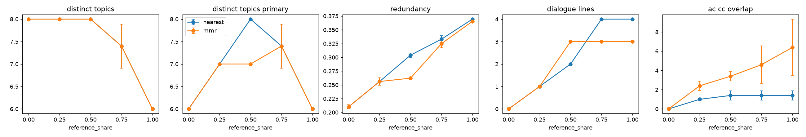

# A4 — Ratio as a dial (no LLM)

**Status: PASS**

Shares [0.0, 0.25, 0.5, 0.75, 1.0] × seeds [41, 42, 43, 44, 45] × variants ['nearest', 'mmr'], total 12. Pass rule: Spearman rho(share, distinct topics) <= -0.7.

Parity with the game's composition: see `a4_parity.md`.

## `nearest`

Spearman ρ(share, distinct topics): -0.81 (first label only: 0.06); ρ(share, redundancy): 0.99

| share | distinct_topics | distinct_topics_primary | redundancy | dialogue_lines | ac_cc_overlap |
|---|---|---|---|---|---|
| 0.000 | 8.00 ± 0.00 | 6.00 ± 0.00 | 0.21 ± 0.00 | 0.00 ± 0.00 | 0.00 ± 0.00 |
| 0.250 | 8.00 ± 0.00 | 7.00 ± 0.00 | 0.26 ± 0.01 | 1.00 ± 0.00 | 1.00 ± 0.00 |
| 0.500 | 8.00 ± 0.00 | 8.00 ± 0.00 | 0.30 ± 0.00 | 2.00 ± 0.00 | 1.40 ± 0.49 |
| 0.750 | 7.40 ± 0.49 | 7.40 ± 0.49 | 0.33 ± 0.01 | 4.00 ± 0.00 | 1.40 ± 0.49 |
| 1.000 | 6.00 ± 0.00 | 6.00 ± 0.00 | 0.37 ± 0.00 | 4.00 ± 0.00 | 1.40 ± 0.49 |

## `mmr`

Spearman ρ(share, distinct topics): -0.81 (first label only: 0.07); ρ(share, redundancy): 0.97

| share | distinct_topics | distinct_topics_primary | redundancy | dialogue_lines | ac_cc_overlap |
|---|---|---|---|---|---|
| 0.000 | 8.00 ± 0.00 | 6.00 ± 0.00 | 0.21 ± 0.00 | 0.00 ± 0.00 | 0.00 ± 0.00 |
| 0.250 | 8.00 ± 0.00 | 7.00 ± 0.00 | 0.26 ± 0.01 | 1.00 ± 0.00 | 2.40 ± 0.49 |
| 0.500 | 8.00 ± 0.00 | 7.00 ± 0.00 | 0.26 ± 0.00 | 3.00 ± 0.00 | 3.40 ± 0.49 |
| 0.750 | 7.40 ± 0.49 | 7.40 ± 0.49 | 0.32 ± 0.01 | 3.00 ± 0.00 | 4.60 ± 1.96 |
| 1.000 | 6.00 ± 0.00 | 6.00 ± 0.00 | 0.37 ± 0.00 | 3.00 ± 0.00 | 6.40 ± 2.94 |

