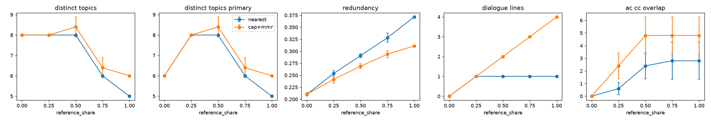

# A4 — Ratio as a dial (no LLM)

**Status: PASS**

Shares [0.0, 0.25, 0.5, 0.75, 1.0] × seeds [41, 42, 43, 44, 45] × variants ['nearest', 'cap+mmr'], total 12. Pass rule: Spearman rho(share, distinct topics) <= -0.7.

Parity with the game's composition: see `a4_parity.md`.

## `nearest`

Spearman ρ(share, distinct topics): -0.89 (first label only: -0.53); ρ(share, redundancy): 0.99

| share | distinct_topics | distinct_topics_primary | redundancy | dialogue_lines | ac_cc_overlap |
|---|---|---|---|---|---|
| 0.000 | 8.00 ± 0.00 | 6.00 ± 0.00 | 0.21 ± 0.00 | 0.00 ± 0.00 | 0.00 ± 0.00 |
| 0.250 | 8.00 ± 0.00 | 8.00 ± 0.00 | 0.25 ± 0.01 | 1.00 ± 0.00 | 0.60 ± 0.49 |
| 0.500 | 8.00 ± 0.00 | 8.00 ± 0.00 | 0.29 ± 0.00 | 1.00 ± 0.00 | 2.40 ± 1.02 |
| 0.750 | 6.00 ± 0.00 | 6.00 ± 0.00 | 0.33 ± 0.01 | 1.00 ± 0.00 | 2.80 ± 1.47 |
| 1.000 | 5.00 ± 0.00 | 5.00 ± 0.00 | 0.37 ± 0.00 | 1.00 ± 0.00 | 2.80 ± 1.47 |

## `cap+mmr`

Spearman ρ(share, distinct topics): -0.77 (first label only: -0.20); ρ(share, redundancy): 0.99

| share | distinct_topics | distinct_topics_primary | redundancy | dialogue_lines | ac_cc_overlap |
|---|---|---|---|---|---|
| 0.000 | 8.00 ± 0.00 | 6.00 ± 0.00 | 0.21 ± 0.00 | 0.00 ± 0.00 | 0.00 ± 0.00 |
| 0.250 | 8.00 ± 0.00 | 8.00 ± 0.00 | 0.24 ± 0.01 | 1.00 ± 0.00 | 2.40 ± 1.02 |
| 0.500 | 8.40 ± 0.49 | 8.40 ± 0.49 | 0.27 ± 0.01 | 2.00 ± 0.00 | 4.80 ± 1.47 |
| 0.750 | 6.40 ± 0.49 | 6.40 ± 0.49 | 0.29 ± 0.01 | 3.00 ± 0.00 | 4.80 ± 1.47 |
| 1.000 | 6.00 ± 0.00 | 6.00 ± 0.00 | 0.31 ± 0.00 | 4.00 ± 0.00 | 4.80 ± 1.47 |

